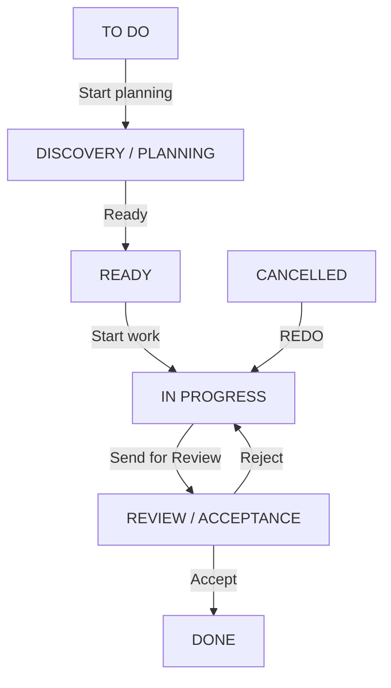
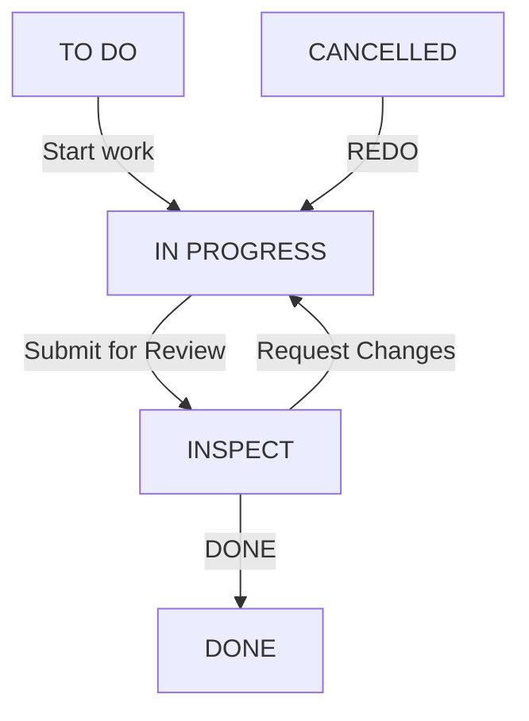
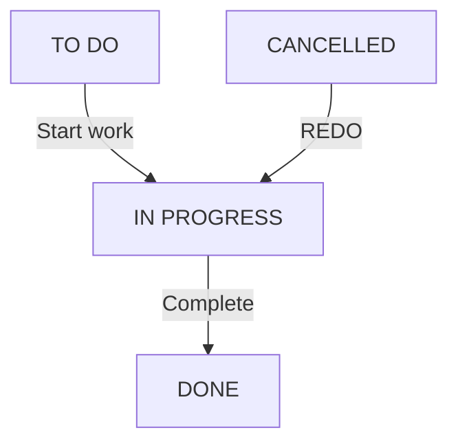

# OpenProject Community: cài đặt Windows và triển khai mở rộng cho nhóm 3 người

## Chạy API đọc dữ liệu OpenProject trên máy local

Cấu hình `apps/api/.env` với `OPENPROJECT_BASE_URL`, `OPENPROJECT_INSTANCE_ID` và `OPENPROJECT_SERVICE_TOKEN` (hoặc `OPENPROJECT_API_TOKEN`). Không đưa token vào frontend hay Git. Chạy trong `apps/api`:

```powershell
npm ci
npm run backend
```

Gọi `GET http://127.0.0.1:3001/dashboard?projectId=6` để lấy dữ liệu. Người làm web cần tích hợp API này; giao diện đã được trả về bản gốc. API chạy local, chưa có xác thực cho nhiều người; chưa kết nối baseline và ngày nghiệm thu nên chưa tính điểm hoàn chỉnh. Xem `docs/api-contract.md`.

**Phiên bản tài liệu:** 1.2 — 10/10/2026 — workflow riêng Epic/Story/Task/Subtask theo bốn ảnh; cập nhật phân quyền và AI/MCP  
**Người dùng:** nhóm 3 người phát triển trên Windows hoặc macOS, bàn giao qua Git.  
**Phạm vi:** AI tạo/cập nhật công việc qua MCP, thống kê task/bug, tính điểm cá nhân.

## 1. Kết quả cần đạt

Nhóm xây một ứng dụng mở rộng kết nối với OpenProject Community qua API v3:

1. AI tạo Epic, Story, Task, Subtask và Bug.
2. AI cập nhật nội dung, người phụ trách, ngày và trạng thái công việc.
3. Báo cáo công việc và bug theo người, task và dự án.
4. Tính điểm cá nhân có giải thích từng khoản cộng/trừ.

OpenProject lưu công việc và workflow. Ứng dụng mở rộng lưu các quy tắc điểm, hạn đã cam kết và dữ liệu quy trách nhiệm. Đây là thiết kế do nhóm triển khai. MCP tích hợp sẵn của OpenProject thuộc Enterprise Professional trở lên; tài liệu này dùng MCP riêng để kết nối Community qua API, không yêu cầu mua MCP tích hợp sẵn [1][2]. Chi phí dịch vụ AI phụ thuộc công cụ/model nhóm chọn, không nằm trong phí OpenProject Community.

**Dự án chưa phải ứng dụng AI chạy hoàn chỉnh.** Bản thống kê local và giới hạn được mô tả ở đầu README. File Compose dùng để chạy OpenProject thử nghiệm.

### Công nghệ đề xuất

| Thành phần | Lựa chọn | Lý do |
|---|---|---|
| Quản lý công việc | OpenProject Community 17.x trong Docker | Phù hợp bản nhóm đã cài trên Mac |
| API mở rộng và MCP | Node.js 22 LTS + TypeScript | Một ngôn ngữ chung với giao diện; chọn SDK MCP tương thích client |
| Giao diện báo cáo | React + Vite + TypeScript | Chạy bằng trình duyệt |
| Dữ liệu bổ sung | SQLite ở backend | Nhẹ, đủ cho bản local một máy; không thay PostgreSQL của OpenProject |
| Bàn giao mã nguồn | Git + repository riêng trên GitHub | Không cần chung Wi-Fi hoặc cùng giờ |

Node 22 vẫn là nhánh LTS tại thời điểm đối chiếu [13]. A chọn bản SDK MCP ổn định tương thích Node/client, rồi khóa phiên bản bằng lockfile; không trộn ví dụ SDK v1 và v2 [14]. Nếu sau này đưa backend lên máy chủ cho nhiều người, nhóm xem lại lưu trữ và xác thực.

## 2. Chuẩn bị Windows

Ưu tiên Windows 11 64 bit còn trong thời gian hỗ trợ, CPU Intel/AMD; kiểm tra phiên bản/edition với trang Docker chính thức [3]. Docker yêu cầu ít nhất 8 GB RAM cho cấu hình WSL 2 được liệt kê; nhóm nên có 16 GB RAM và khoảng 30 GB dung lượng trống để chạy thử thoải mái. Hai con số khuyến nghị sau là đề xuất của tài liệu.

### Bước 1 — Kiểm tra ảo hóa

Mở Task Manager → Performance → CPU, tìm **Virtualization: Enabled**. Nếu Disabled, bật Intel VT-x hoặc AMD-V trong BIOS/UEFI theo hướng dẫn hãng máy. Docker Desktop phải chạy **Linux containers**.

### Bước 2 — Cài WSL 2

Mở PowerShell bằng **Run as administrator**, chạy:

```powershell
wsl --install
```

Khởi động lại máy nếu được yêu cầu; hoàn thành bước tạo người dùng Ubuntu nếu cửa sổ Ubuntu xuất hiện. Sau đó mở PowerShell và kiểm tra:

```powershell
wsl --update
wsl --version
wsl --status
wsl -l -v
```

WSL phải dùng version 2. Nếu Ubuntu hiện version 1, dùng `wsl --set-version Ubuntu 2`; thay Ubuntu bằng tên chính xác trong danh sách. Docker yêu cầu WSL 2.1.5 trở lên theo tài liệu đã đối chiếu [3][4].

### Bước 3 — Cài Docker Desktop

Tải từ https://docs.docker.com/desktop/setup/install/windows-install/.

Chọn bản Windows x86_64 cho Intel/AMD. Cài, mở Docker Desktop; dùng WSL 2 backend nếu trình cài đặt cho lựa chọn. Đợi Docker Engine hoạt động, rồi mở PowerShell mới:

```powershell
docker version
docker compose version
docker info --format '{{.OSType}}'
```

Lệnh cuối phải trả về `linux`. Nếu không có phần Server trong `docker version`, kiểm tra Docker Desktop đã mở và WSL đã hoạt động. Docker Desktop có điều kiện cấp phép riêng; nhóm học tập/cá nhân kiểm tra điều khoản ở trang cài đặt, đặc biệt nếu sau này dùng trong doanh nghiệp [3].

### Bước 4 — Cài công cụ phát triển

- Git for Windows: https://git-scm.com/downloads/win
- Node.js 22 LTS: https://nodejs.org/en/download
- Trình soạn thảo tùy chọn: VS Code hoặc công cụ quen dùng.

Kiểm tra trong PowerShell mới:

```powershell
git --version
node --version
npm --version
```

## 3. Tải và chạy OpenProject trên Windows

Hướng dẫn dùng **một container all-in-one để thử nghiệm local**, cùng kiểu với máy Mac của bạn. OpenProject khuyến nghị Compose nhiều dịch vụ với ảnh slim cho vận hành lâu dài; xem [5][6] khi chuyển sang máy chủ. Không có trình cài OpenProject `.exe` trong quy trình này.

### Bước 1 — Giải nén bộ khung

Giải nén ZIP để có đường dẫn:

```text
C:\Projects\openproject-ai\README.md
```

Nếu chọn thư mục khác, thay đường dẫn trong các lệnh. Không giải nén đè lên mã nguồn đang làm của nhóm.

### Bước 2 — Tạo cấu hình riêng của máy

Trong PowerShell:

```powershell
Set-Location C:\Projects\openproject-ai
powershell -NoProfile -ExecutionPolicy Bypass -File .\scripts\init-openproject-env.ps1
Set-Location .\infra\openproject
docker compose config --quiet
```

Script đi kèm tạo `.env` với khóa ngẫu nhiên, không ghi đè file đã tồn tại. Chỉ dùng `ExecutionPolicy Bypass` cho lần chạy file này sau khi đọc nội dung; không cần đổi chính sách toàn máy. Giữ nguyên khóa qua các lần khởi động và giữ bản cấu hình riêng khi chuyển dữ liệu [5].

### Bước 3 — Tải image và khởi động

```powershell
docker compose pull
docker compose up -d
docker compose ps
docker compose logs --tail 100 openproject
```

Lần đầu có thể mất nhiều phút vì tải image và khởi tạo dữ liệu. Khi sẵn sàng, mở **http://localhost:8080**. Tài khoản khởi tạo thường là `admin` / `admin`; đổi mật khẩu ngay khi đăng nhập [5]. Nếu gặp 503, xem bảng xử lý lỗi ở dưới; container Up chưa chứng minh web đã sẵn sàng.

### File Compose đi kèm

File `infra/openproject/compose.yaml` chứa:

```yaml
services:
  openproject:
    image: ${OPENPROJECT_IMAGE:-openproject/openproject:17}
    restart: unless-stopped
    ports:
      - "127.0.0.1:8080:80"
    environment:
      SECRET_KEY_BASE: ${SECRET_KEY_BASE:?Run init-openproject-env.ps1 first}
      OPENPROJECT_HOST__NAME: localhost:8080
      OPENPROJECT_HTTPS: "false"
      OPENPROJECT_DEFAULT__LANGUAGE: en
    volumes:
      - pgdata:/var/openproject/pgdata
      - assets:/var/openproject/assets
volumes:
  pgdata:
  assets:
```

Đây là cấu hình local của nhóm, dựa trên các tham số Docker chính thức [5]. Named volumes giữ cơ sở dữ liệu và tệp đính kèm. Port chỉ nghe trên máy đó; bạn bè ở máy khác không vào bằng localhost của bạn. HTTP local này phục vụ thử nghiệm.

### Bước 4 — Ghi nhận phiên bản chung

Tag `17` có thể trỏ đến bản 17.x khác theo thời gian. Sau khi cả nhóm thống nhất bản hoạt động, ghi bản OpenProject trong giao diện quản trị và digest:

```powershell
docker image inspect openproject/openproject:17 --format '{{index .RepoDigests 0}}'
```

Chép giá trị thực nhận được vào `OPENPROJECT_IMAGE=` trong `.env`, đồng thời ghi vào `docs/environment.md`. Không tự điền một digest giả. Khi chuyển dữ liệu giữa máy, dùng cùng phiên bản trước khi khôi phục.

### Khởi động những lần sau

Mở Docker Desktop trước, vào `infra/openproject`, rồi dùng:

```powershell
docker compose up -d
```

Dừng để nghỉ: `docker compose stop`. Tạo lại container khi đổi cấu hình: `docker compose up -d`. **Không dùng `docker compose down -v` để dừng thông thường:** cờ `-v` có thể xóa các volume chứa dữ liệu.

### Xử lý lỗi thường gặp

| Hiện tượng | Kiểm tra và xử lý |
|---|---|
| `docker` không được nhận diện | Mở PowerShell mới; kiểm tra Docker Desktop đã cài |
| Không kết nối Docker daemon | Mở Docker Desktop; kiểm tra WSL và ảo hóa |
| Port 8080 đã được dùng | Dừng ứng dụng đang giữ port, hoặc đổi port cùng `OPENPROJECT_HOST__NAME` |
| Web trả 503 | Xem logs, `docker stats --no-stream`; đợi khởi tạo, xử lý lỗi RAM/database nếu có |
| Container restart liên tục | Xem lỗi đầu tiên trong logs; kiểm tra khóa `.env` và bộ nhớ |
| Đăng nhập được nhưng thiếu type/trạng thái | Kiểm tra type đã bật trong dự án và workflow của đúng role |

503 không nên được xử lý bằng cách xóa volume. Khi nhờ hỗ trợ, gửi logs đã loại token/mật khẩu và phiên bản Windows, Docker, OpenProject.

## 4. Tạo dự án và tài khoản nhóm

### Dự án trong OpenProject

Người A thực hiện trên môi trường tích hợp:

1. Tạo dự án **OpenProject AI Extension**, identifier dự kiến `op-ai`.
2. Bật Work packages, Wiki và Time and costs nếu nhóm cần ghi thời gian.
3. Tạo tài khoản A, B, C để nhận công việc; thêm vào Members của dự án.
4. Tạo các project role **PM**, **BA**, **BE**, **FE**, **Tester** trong Administration → Users and permissions → Roles and permissions [7]. Cấu hình quyền theo mục 4.1 và workflow riêng theo từng type ở mục 5; không dùng một workflow chung cho tất cả.
5. Gán quyền theo mục 4.1, đặc biệt tắt quyền sửa trực tiếp rộng cho BE/FE. PM quản lý thành viên và kế hoạch. Không cấp quyền xóa công việc cho tài khoản AI ở bản đầu.

Administrator là quyền toàn hệ thống; role PM trong dự án không tự có quyền sửa cấu hình toàn hệ thống. Người quản trị thực hiện phần workflow bên dưới [7]. Tránh đồng thời gán thêm role rộng quyền khi kiểm tra workflow, vì các quyền có thể cộng dồn.

### Các loại công việc

Vào Administration → Work packages → Types. Dùng loại đã có; tạo loại thiếu bằng **+ Type**, không đánh dấu là Milestone. Sau đó bật chúng tại Project settings → Work packages → Types [8][9].

| Type | Dùng để làm gì |
|---|---|
| Epic | Một mục tiêu lớn, ví dụ tích hợp AI hoặc báo cáo |
| Story | Kết quả người dùng cần, có tiêu chí chấp nhận |
| Task | Một việc triển khai cụ thể |
| Subtask | Phần nhỏ của task, có người và hạn riêng khi cần |
| Bug | Lỗi đã phát hiện, có bước tái hiện và liên kết nguồn |

Dùng quan hệ Parent/Child để tạo Epic → Story/Task → Subtask. Đây là quy ước nhóm; tên type không tự ép được toàn bộ cấu trúc phân cấp. Với Bug, đặt Bug làm con trực tiếp của Task hoặc Subtask nguồn; giao Bug cho đúng assignee đang chịu trách nhiệm công việc nguồn. Web/API dùng quan hệ cha–con này để thống kê và trừ điểm; không dùng `relates` làm nguồn trừ điểm [10].

### API token

Đăng nhập tài khoản dự định dùng để tích hợp; vào My account → Access tokens để tạo token API [11]. API hành động với quyền tài khoản của token [2]. Bản phát triển một người có thể cấu hình token riêng ở backend. Khi bật phân quyền nhiều thành viên theo mục 4.1, token người dùng thường không có quyền sửa rộng; token tài khoản dịch vụ có quyền ghi chỉ được giữ trên backend do quản lý vận hành. Không phát token dịch vụ cho máy BE/FE, frontend, README, Git hoặc dữ liệu mẫu.

### 4.1. Phân quyền PM, BA, BE, FE và Tester

#### 4.1.1. Vai trò và phạm vi

| Role | Công việc chính | Phạm vi được sửa theo chính sách nhóm |
|---|---|---|
| PM — Project Manager | Quản lý kế hoạch, giao việc, hạn, nghiệm thu, điểm | Công việc trong dự án được quản lý; sửa kế hoạch phải có lý do |
| BA — Business Analyst | Phân tích yêu cầu, Epic/Story, tiêu chí chấp nhận | Nội dung nghiệp vụ của Epic/Story được chỉ định và task BA được giao |
| BE — Backend Developer | API, cơ sở dữ liệu, xử lý nghiệp vụ phía server | Trường thực thi của task/subtask/bug BE được giao trực tiếp cho mình |
| FE — Frontend Developer | Giao diện và tích hợp API | Trường thực thi của task/subtask/bug FE được giao trực tiếp cho mình |
| Tester | Kiểm thử, xác nhận bug, review kết quả | Task kiểm thử được giao; trường kết quả kiểm thử và trạng thái review được chỉ định |

A/B/C là **người được chia phần triển khai dự án mở rộng**, không phải role quyền cố định. Một người có thể làm nhiều chuyên môn, nhưng role phải được gán theo từng dự án và kiểm tra tổng quyền. BE trong bảng này là vai trò của thành viên sử dụng hệ thống; không đồng nghĩa người A/B đang viết backend của ứng dụng mở rộng.

Quy tắc mặc định được chọn: **BE/FE chỉ sửa task của chính mình**, chặt hơn việc cho mọi BE sửa mọi task BE. Task FE của đồng nghiệp cũng bị chặn đối với FE khác. Task chưa assign hoặc assign cho group chưa có cá nhân đại diện chỉ do PM điều phối; backend không tự mở quyền cho cả nhóm.

Mỗi work package cần `workstream` được PM duyệt: `BE`, `FE`, `BA`, `QA` hoặc `PM`; Epic/Story dùng thông tin người phụ trách nghiệp vụ. Bản đầu có thể lưu metadata này trong SQLite. Người dùng thường không được tự sửa workstream để vượt quyền. `assigneeId` lấy từ OpenProject hiện tại; `businessOwnerId` và `reviewerIds` là danh sách được PM/BA có thẩm quyền duyệt, không suy ra từ người tạo task.

#### 4.1.2. Ma trận quyền của ứng dụng mở rộng

Bảng sau là **chính sách cần lập trình trong backend của nhóm**, kết hợp quyền OpenProject và workflow. Đây không phải các ô cấu hình sẵn tương ứng một-một trong Community.

| Thao tác | PM | BA | BE | FE | Tester |
|---|---|---|---|---|---|
| Xem công việc trong dự án có quyền truy cập | Có | Có | Có | Có | Có |
| Bình luận trao đổi trong dự án | Có | Có | Có | Có | Có |
| Tạo Epic/Story | Có | Có, trong phạm vi nghiệp vụ được giao | Không | Không | Không |
| Sửa yêu cầu/tiêu chí của Epic/Story | Có | Có, là business owner | Không | Không | Chỉ đề xuất bằng bình luận |
| Tạo Task/Subtask | Có | Task BA của mình | Task BE của mình | Task FE của mình | Task QA của mình |
| Sửa mô tả thực thi của Task/Subtask | Có | Task BA của mình | Task BE của mình | Task FE của mình | Task QA của mình |
| Đổi assignee, workstream, parent hoặc type của công việc đã tạo | Có | Chỉ đề xuất | Không | Không | Không |
| Đổi hạn gốc, độ khó, tỷ lệ đóng góp đã duyệt | Có, lưu lý do/phiên bản | Chỉ đề xuất | Không | Không | Không |
| Task: TO DO → IN PROGRESS → REVIEW | Khi được giao phù hợp | Task BA của mình | Task BE của mình | Task FE của mình | Task QA của mình |
| Task: REVIEW → DONE/IN PROGRESS | Có, nếu không tự review | Chỉ nếu là reviewer nghiệp vụ được chỉ định | Không | Không | Có, nếu là reviewer được chỉ định |
| Subtask: IN PROGRESS → DONE (Complete) | Subtask của mình | Subtask BA của mình | Subtask BE của mình | Subtask FE của mình | Subtask QA của mình |
| Any → CANCELLED; CANCELLED → IN PROGRESS (REDO) | Có, theo mục 5.6 | Chỉ đề xuất | Không | Không | Không |
| Chấp nhận Done của Epic/Story | Có, nếu đạt điều kiện | Chỉ đề xuất nghiệm thu | Không | Không | Chỉ cung cấp kết quả kiểm thử |
| Tạo Bug với mô tả và bằng chứng | Có | Có | Có | Có | Có |
| Duyệt bug hợp lệ, mức độ và task nguồn | Có | Chỉ đề xuất | Chỉ đề xuất | Chỉ đề xuất | Có, theo phạm vi review được giao |
| Sửa nội dung khắc phục của Bug | Có | Bug BA được giao | Bug BE được giao | Bug FE được giao | Trường kết quả kiểm thử của bug được giao |
| Xem bảng điểm | Toàn dự án | Toàn dự án | Điểm của mình, tổng hợp nhóm | Điểm của mình, tổng hợp nhóm | Điểm của mình, tổng hợp nhóm |
| Đổi công thức/chốt hoặc hiệu chỉnh điểm | Có, có version/lý do | Không | Không | Không | Không |
| Xóa work package | Không qua ứng dụng ở bản đầu | Không | Không | Không | Không |

Task/Subtask tạo mới của BE/FE/BA/Tester mặc định TO DO, assign chính người đó, workstream khớp role. PM duyệt kế hoạch/baseline trước Start work; READY chỉ có trong workflow Epic. Người tạo được chỉnh nội dung bản nháp trong phạm vi của mình; việc tự tạo không cấp quyền sửa công việc người khác. Khi gắn Subtask mới vào parent khác người phụ trách, cần PM duyệt quan hệ; quyền tạo không đồng nghĩa quyền sửa parent.

BA chỉ sửa trường nghiệp vụ của Epic/Story, không tự điều chỉnh baseline hoặc trạng thái Done. Tester review task BE/FE chỉ được ghi kết quả kiểm thử, bằng chứng và chuyển trạng thái review hợp lệ; không tự sửa yêu cầu, người được giao hoặc độ khó. Bug đã được duyệt không cho tác giả tự thay task nguồn/severity để giảm điểm trừ.

#### 4.1.3. Ví dụ BE không được sửa task assign FE

Giả sử task 123 có workstream FE, assignee là tài khoản của Lan. Minh có role BE, đăng nhập bằng tài khoản riêng:

- Minh được xem và bình luận trao đổi nếu có quyền xem dự án.
- Minh bị chặn sửa subject, description, ngày, priority, assignee, parent và status của task 123.
- Minh yêu cầu AI “chuyển task 123 sang Done” cũng bị chặn với lỗi quyền; MCP không gửi yêu cầu ghi sang OpenProject.
- Minh không được dùng một lệnh đổi assignee thành mình rồi sửa trong cùng request để lách kiểm tra.
- Chỉ PM được điều phối lại. Nếu giao sang BE, PM phải duyệt thay workstream/phạm vi và cập nhật baseline/tỷ lệ đóng góp theo lịch sử, không ghi đè người nhận điểm cũ.

Ngay cả task BE được assign cho một BE khác, Minh vẫn không được sửa theo quy tắc “chỉ task của chính mình”. Nếu cùng làm, PM tách Subtask riêng cho từng người. Việc ghi nhận tỷ lệ đóng góp để tính điểm không tự cấp quyền sửa task.

#### 4.1.4. Khả năng sẵn có của Community và phương án áp dụng

OpenProject có quyền **Edit work packages** ở cấp dự án và quyền **Change work package status** độc lập. Workflow có điều kiện User is assignee, nhưng điều kiện đó áp dụng cho chuyển trạng thái, không tự hạn chế việc sửa toàn bộ nội dung theo assignee [23][15]. Các nguồn đã kiểm tra không cung cấp một quyền cấu hình chung “chỉ sửa mọi trường của task assign mình”. Không được ghi rằng chỉ tạo role BE/FE là đã hoàn thành yêu cầu này.

Phương án mặc định cho nhóm:

1. OpenProject gốc dùng để xem task, lịch sử và bình luận. BA/BE/FE/Tester không được cấp **Edit work packages** hoặc **Change work package status** trực tiếp ở cấu hình nghiêm ngặt.
2. Mọi thao tác tạo/sửa/chuyển trạng thái theo ma trận thực hiện qua giao diện mở rộng hoặc AI → MCP → backend có kiểm tra quyền. PM có thể có quyền quản lý trực tiếp trong OpenProject theo phạm vi được tin cậy.
3. Backend giữ token của **tài khoản dịch vụ không phải Administrator**, chỉ có các quyền cần dùng trong dự án. Backend xác thực người thao tác và kiểm tra ma trận trước khi dùng token đó; token dịch vụ không phải danh tính của người yêu cầu.
4. Backend dịch vụ chỉ được PM/người vận hành kiểm soát. Trên máy thành viên, MCP stdio kết nối backend bằng danh tính đã xác thực của thành viên; không nhúng token dịch vụ vào chương trình local mà thành viên có thể đọc hoặc sửa.
5. Nếu muốn BE/FE sửa trực tiếp mọi trường trên UI OpenProject mà vẫn giới hạn theo assignee, cần bổ sung kiểm tra phía server OpenProject bằng một mở rộng được phát triển/kiểm thử riêng, hoặc một cơ chế quyền cấp từng work package đã được xác minh. Bộ scaffold hiện tại không có chức năng đó. Chặn tại MCP hoặc ẩn nút UI không chặn được đường sửa trực tiếp khi tài khoản vẫn có quyền Edit rộng.

Mỗi người vẫn có thể phát triển bằng mock/môi trường riêng như mục 12. Khi cả nhóm dùng một hệ thống thật, phải có backend đáng tin cậy và xác thực; ba bản local do từng thành viên toàn quyền quản lý không tạo được một ranh giới quyền chung đáng tin cậy.

#### 4.1.5. Cấu hình project role trong OpenProject

Administrator thực hiện tại Administration → Users and permissions → Roles and permissions, tạo project role (không đánh dấu Global role), rồi gán qua Members của dự án:

| Quyền gốc OpenProject | PM | BA/BE/FE/Tester trong cấu hình nghiêm ngặt | Tài khoản dịch vụ |
|---|---|---|---|
| View work packages | Bật | Bật | Bật |
| Add comments / Edit own comments | Bật | Bật | Bật nếu ứng dụng hỗ trợ |
| Become assignee/responsible | Bật | Bật | Theo nhu cầu, không cần là người thực hiện task |
| Add work packages / Edit work packages | Bật theo nhiệm vụ | Tắt; dùng ứng dụng mở rộng | Bật trong dự án đích |
| Change work package status | Bật | Tắt; dùng ứng dụng mở rộng | Bật và cấu hình workflow riêng phù hợp |
| Manage work package relations/hierarchies | Bật | Tắt | Bật theo các thao tác được hỗ trợ |
| Add attachments | Theo nhu cầu | Tắt nếu phải kiểm tra quyền theo task; gửi qua ứng dụng | Chỉ bật khi có chức năng upload kiểm tra quyền |
| Move/Duplicate/Delete work packages | Tắt ở bản đầu nếu không cần | Tắt | Tắt |
| Manage members / cấu hình dự án | PM theo nhiệm vụ | Tắt | Tắt |
| Administrator / quyền quản trị toàn hệ thống | Không mặc định | Tắt | Tắt |

Nguồn [23] mô tả ý nghĩa các quyền. Bảng bật/tắt này là đề xuất của nhóm. Không dùng Non-member/Anonymous để cho truy cập dự án riêng; kiểm tra các role bổ sung hoặc group không cấp lại quyền đã tắt. Add attachments hoạt động độc lập với Edit work packages, vì vậy phải kiểm tra riêng [23].

Workflow mục 5 thể hiện chính sách nghiệp vụ. Trong cấu hình nghiêm ngặt, tài khoản người dùng thường không đổi trạng thái trực tiếp; backend áp ma trận role/người được giao/người review, rồi dùng workflow của tài khoản dịch vụ để ghi. Workflow của tài khoản dịch vụ phải hỗ trợ những chuyển trạng thái đã được backend cho phép. Điều kiện User is assignee của role BE không tự áp dụng khi OpenProject thấy tài khoản dịch vụ là người ghi.

#### 4.1.6. Kiểm tra bắt buộc trong backend/AI-MCP

Người A xây `auth/` và `permissions/`, dùng chung cho REST/MCP. Trình tự mỗi thao tác:

1. Xác thực actor từ phiên đăng nhập/token đã kiểm chứng; không tin `actorId`, `role=PM` hay câu “tôi là PM” trong prompt/body của AI.
2. Lấy role và quyền trong dự án, công việc hiện tại, assignee, workstream, businessOwner/reviewer và trạng thái từ nguồn đáng tin cậy.
3. Kiểm tra cả quyền thao tác và từng trường thay đổi. BE/FE cần đúng role/workstream và `actor.userId == currentAssigneeId`; task đang DONE/CANCELLED không cho sửa thực thi nếu chưa được mở lại hợp lệ.
4. Thay đổi assignee/type/workstream/parent/baseline chỉ thuộc PM. Đánh giá bằng dữ liệu **trước thay đổi**; không cho payload tự chuyển quyền cho actor.
5. Reviewer phải được chỉ định, không phải người thực hiện/nhận đóng góp của task. PM tự làm task cũng cần người review khác hoặc ngoại lệ được phê duyệt, ghi rõ lý do.
6. Dùng lockVersion; nếu task được PM đổi assignee trong lúc thao tác, từ chối bản ghi cũ và kiểm tra quyền lại trên bản mới.
7. Ghi audit actor thực, tài khoản dịch vụ, task ID, action, thay đổi, kết quả, thời gian. OpenProject có thể hiển thị tài khoản dịch vụ là người ghi; không được diễn giải đó là người làm task.
8. Request nhiều task kiểm tra từng mục trước khi ghi. Nếu kế hoạch có mục không được phép, bản đầu từ chối cả kế hoạch và trả danh sách nguyên nhân; lỗi phát sinh sau khi ghi phải báo chính xác các mục đã/ chưa cập nhật.

Không dùng endpoint cập nhật tổng quát hoặc chuyển tiếp payload tùy ý để bypass `permissions/`. Với quan hệ cha/con hoặc bug nguồn, kiểm tra các đầu mút liên quan. Cấu hình quyền phải được version hóa; nguồn role hoặc task không lấy được thì không cho ghi theo dữ liệu cũ.

#### 4.1.7. Phân công bổ sung và nghiệm thu

| Người triển khai | Bổ sung vào phần việc |
|---|---|
| A | Xác thực actor, ma trận role/trường, kiểm tra assignee, bảo vệ mọi tool MCP/REST và tài khoản dịch vụ |
| B | Lưu metadata workstream/businessOwner/reviewer, lịch sử giao lại, audit và ánh xạ ID; báo cáo đúng phạm vi được xem |
| C | Giao diện chỉ cho thao tác hợp lệ, giải thích bị chặn, giới hạn bảng điểm cá nhân; backend vẫn kiểm tra độc lập |

Các tình huống phải được kiểm tra trên hệ thống đã triển khai:

| Tình huống | Kết quả mong đợi |
|---|---|
| BE sửa nội dung/chuyển trạng thái task FE | Từ chối; dữ liệu task không đổi |
| BE sửa task BE của chính mình | Cho phép các trường thực thi và chuyển trạng thái hợp lệ |
| BE sửa task BE của người khác hoặc task chưa assign | Từ chối |
| FE đổi assignee/workstream/type để tự nhận quyền | Từ chối |
| BA sửa tiêu chí Story mình phụ trách | Cho phép; không đổi baseline/Done |
| Tester được chỉ định review task BE | Cho phép ghi kết quả và REVIEW → DONE/IN PROGRESS; không sửa mô tả thực thi |
| Tester không được chỉ định review task đó | Từ chối thao tác review; vẫn được bình luận theo quyền |
| PM đổi assignee sang FE | Cho phép, có audit; BE mất quyền sửa ngay sau đổi |
| Actor giả PM trong prompt/payload, hoặc dùng ID task dự án khác | Từ chối |
| BE gọi thẳng OpenProject API hoặc UI để sửa task FE | Bị từ chối vì role gốc không có quyền sửa trực tiếp rộng |
| Bulk update chứa cả task BE của mình và task FE | Từ chối kế hoạch trước ghi ở bản đầu |
| BE gọi API bảng điểm cá nhân của người khác | Không trả chi tiết ngoài phạm vi; chỉ tổng hợp được phép |

Đây là tiêu chí nghiệm thu thiết kế, không phải kết quả test đã chạy. Tài liệu và ZIP chưa chứa implementation phân quyền. Chỉ xem chức năng hoàn thành khi các phép thử UI, REST, MCP và gọi API trực tiếp đều đạt theo mô hình được chọn.

## 5. Workflow Epic, Story, Task và Subtask theo ảnh nhóm cung cấp

**Nguồn nghiệp vụ:** bốn ảnh ngày 10/10/2026, theo thứ tự Epic, Story, Task, Subtask. Các luồng dưới đây thay thế workflow chung ở phiên bản 1.1. Tên trạng thái và hành động giữ đúng ảnh; quyền thực hiện và điều kiện nghiệm thu là chính sách bổ sung của nhóm, không được suy ra từ ảnh.

**Workflow là các chuyển trạng thái được phép theo Type và Role.** Người quản trị cấu hình trạng thái và workflow trong Administration → Work packages [12][15]. Trong mô hình phân quyền nghiêm ngặt ở mục 4.1, backend kiểm tra actor thật rồi ghi bằng tài khoản dịch vụ; workflow của dịch vụ không thay thế kiểm tra quyền người dùng.

### 5.1. Danh sách trạng thái và quy ước

| Trạng thái | Áp dụng | Ý nghĩa | Closed? |
|---|---|---|---|
| TO DO | Cả bốn type | Đã tạo, chưa bắt đầu | Không |
| DISCOVERY / PLANNING | Epic | Khám phá phạm vi, lập kế hoạch | Không |
| READY | Epic | Kế hoạch Epic đã sẵn sàng | Không |
| IN PROGRESS | Cả bốn type | Đang thực hiện | Không |
| REVIEW / ACCEPTANCE | Epic | Đang nghiệm thu mục tiêu Epic | Không |
| INSPECT | Story | Kiểm tra kết quả theo tiêu chí Story | Không |
| REVIEW | Task | Review công việc triển khai | Không |
| DONE | Cả bốn type | Hoàn tất theo điều kiện của type | Có |
| CANCELLED | Cả bốn type | Đã hủy, có thể REDO | Có |

`START` là điểm khởi tạo, `Any` biểu thị mọi trạng thái nguồn, còn Create, REDO, Reject, Request Changes… là **tên hành động chuyển trạng thái**, không phải trạng thái riêng. Không tạo trạng thái START, Any hoặc REDO. Không dùng NEW hoặc REWORK cho bốn type này. READY chỉ dành cho Epic; Subtask không có REVIEW/INSPECT.

Đặt **TO DO** làm trạng thái khởi tạo của cả bốn type. CANCELLED đóng về kỹ thuật nhưng không được tính hoàn thành/điểm. DONE của Subtask là hoàn tất do người thực hiện khai báo; nghiệm thu độc lập và điểm được kiểm soát ở task cha (mục 5.7). Không nhận biết hoàn thành chỉ bằng `% Complete = 100`.

### 5.2. Epic — ảnh 1



| Từ | Hành động trong ảnh | Đến |
|---|---|---|
| START | Create | TO DO |
| TO DO | Start planning | DISCOVERY / PLANNING |
| DISCOVERY / PLANNING | Ready | READY |
| READY | Start work | IN PROGRESS |
| IN PROGRESS | Send for Review | REVIEW / ACCEPTANCE |
| REVIEW / ACCEPTANCE | Reject | IN PROGRESS |
| REVIEW / ACCEPTANCE | Accept | DONE |
| Any | Không ghi nhãn trong ảnh | CANCELLED |
| CANCELLED | REDO | IN PROGRESS |

PM chấp nhận Epic khi các Story bắt buộc đã được nghiệm thu và mục tiêu Epic đạt. Epic bị Reject quay thẳng về IN PROGRESS; không thêm bước REWORK.

### 5.3. Story — ảnh 2



| Từ | Hành động trong ảnh | Đến |
|---|---|---|
| START | Create | TO DO |
| TO DO | Start work | IN PROGRESS |
| IN PROGRESS | Submit for Review | INSPECT |
| INSPECT | Request Changes | IN PROGRESS |
| INSPECT | DONE | DONE |
| Any | Không ghi nhãn trong ảnh | CANCELLED |
| CANCELLED | REDO | IN PROGRESS |

Trong ảnh, DONE vừa là nhãn hành động vừa là trạng thái đích. Story không đi qua READY hoặc REVIEW. PM nghiệm thu Story khi tiêu chí chấp nhận đạt và các Task bắt buộc đã được chấp nhận; BA/Tester cung cấp kết quả kiểm tra.

### 5.4. Task — ảnh 3


| Từ | Hành động trong ảnh | Đến |
|---|---|---|
| START | Create | TO DO |
| TO DO | Start work | IN PROGRESS |
| IN PROGRESS | Submit for Review | REVIEW |
| REVIEW | Request Changes | IN PROGRESS |
| REVIEW | Approve | DONE |
| Any | Không ghi nhãn trong ảnh | CANCELLED |
| CANCELLED | REDO | IN PROGRESS |

Người được giao gửi Task sang REVIEW. PM hoặc reviewer được chỉ định chấp nhận/yêu cầu sửa; không tự review công việc có phần đóng góp của mình. Request Changes quay thẳng về IN PROGRESS. BE/FE không tự Approve Task của mình.

### 5.5. Subtask — ảnh 4



| Từ | Hành động trong ảnh | Đến |
|---|---|---|
| START | Create | TO DO |
| TO DO | Start work | IN PROGRESS |
| IN PROGRESS | Complete | DONE |
| Any | Không ghi nhãn trong ảnh | CANCELLED |
| CANCELLED | REDO | IN PROGRESS |

Theo ảnh, Subtask không có bước review riêng. Người được giao có thể Complete Subtask của chính mình khi có bằng chứng hoàn thành, đúng workstream, đạt checklist và có task cha hợp lệ. Đây là khai báo hoàn tất; reviewer vẫn nghiệm thu các phần này khi duyệt task cha. Không tự thêm REVIEW vào workflow Subtask.

### 5.6. Quyền chuyển trạng thái và Any/REDO

| Type / hành động | Người được phép trong ứng dụng mở rộng | Điều kiện bổ sung |
|---|---|---|
| Epic: Start planning, Ready, Start work, Send for Review | PM; BA là business owner được giao | READY cần kế hoạch/phạm vi và tiêu chí được PM duyệt |
| Epic: Reject, Accept | PM | Không tự nghiệm thu; Accept kiểm tra Story bắt buộc |
| Story: Start work, Submit for Review | PM; BA là business owner được giao | Phạm vi đã được PM duyệt; không bỏ qua IN PROGRESS |
| Story: Request Changes | PM; BA/Tester là reviewer được chỉ định | Không tự review; ghi lý do và bằng chứng |
| Story: INSPECT → DONE | PM | Tiêu chí đạt; các Task bắt buộc đã được nghiệm thu |
| Task: Start work, Submit for Review | Assignee BA/BE/FE/Tester đúng workstream; PM khi được giao task đúng phạm vi | Baseline được duyệt trước Start work |
| Task: Request Changes, Approve | PM hoặc BA/Tester là reviewer được chỉ định | Không tự review; Approve kiểm tra Subtask bắt buộc |
| Subtask: Start work, Complete | Assignee đúng workstream; PM khi là assignee hợp lệ | Checklist/bằng chứng; không thay thế nghiệm thu task cha |
| Cả bốn type: Any → CANCELLED | PM | Bắt buộc lý do; hủy việc đang DONE là ngoại lệ có xác nhận rõ |
| Cả bốn type: CANCELLED → IN PROGRESS (REDO) | PM | Duyệt mở lại, xác định phạm vi/baseline; không tự cộng thêm điểm |

`Any → CANCELLED` trong ảnh bao gồm cả DONE. Khi cấu hình, cho phép từ từng trạng thái của type **trừ CANCELLED**; không cần vòng lặp CANCELLED → CANCELLED. Backend chặn người dùng thường hủy hoặc REDO. Với DONE → CANCELLED, PM cần xác nhận rõ ảnh hưởng báo cáo và ghi audit; ảnh không quy định tên hành động hủy nên tài liệu chỉ gọi là “Hủy” để diễn đạt.

Không có cạnh DONE → IN PROGRESS trực tiếp trong ảnh. Mở lại công việc đã DONE theo đúng luồng: **DONE → CANCELLED → IN PROGRESS**. Không tự quay TO DO hoặc REWORK. Hủy/REDO một parent không tự đổi toàn bộ child: PM lập kế hoạch phạm vi, xác nhận những child cần mở lại và backend kiểm tra quyền từng bản ghi. Child CANCELLED chưa được miễn trừ rõ ràng không được coi là child đã nghiệm thu.

### 5.7. Cấu hình OpenProject và AI/MCP

1. Tạo/reuse đúng các trạng thái mục 5.1; chọn Closed cho DONE và CANCELLED. Cấu hình TO DO mặc định và kiểm tra khởi tạo của từng type. Nếu hệ thống có dữ liệu cũ, lập mapping/chuyển đổi có kiểm soát; không đổi tên/xóa trạng thái đang được type khác sử dụng chỉ để sửa demo.
2. Mở workflow của từng Type và Role. Trong ma trận, tích **hàng trạng thái hiện tại → cột trạng thái đích** đúng bảng riêng mục 5.2–5.5 [15]. Không copy nguyên workflow Task sang Story/Subtask/Epic.
3. Với tài khoản dịch vụ, cho phép đủ các cạnh cần ghi của từng type; backend thực thi bảng 5.6 cho actor thật. Với mô hình native hạn chế, User is assignee chỉ hỗ trợ giới hạn chuyển trạng thái; không thay thế quyền sửa field theo mục 4.1. Không cấp thêm User is author để vượt assignee.
4. Các nhãn hành động trong ảnh được lưu trong hợp đồng nghiệp vụ/UI/MCP. Việc tích ô chuyển trạng thái không bảo đảm OpenProject tự tạo nút có đúng nhãn “Accept” hoặc “Submit for Review”; adapter ghi status đích tương ứng.
5. A triển khai công cụ dự kiến `get_allowed_transitions(workPackageId)` và `transition_work_package(workPackageId, action, reason?, expectedLockVersion, requestId)`. Đây là tool riêng cần xây, không phải tool đã có sẵn trong ZIP. Backend xác thực actor, đọc type/status/assignee/reviewer hiện tại, đối chiếu cạnh và điều kiện, rồi mới gọi API cập nhật với lockVersion [18].
6. `update_work_package` có đổi status cũng phải đi qua cùng chính sách; không để tool cập nhật chung bỏ qua workflow. AI không được tự suy ra quyền từ prompt hoặc dùng một luồng chung cho mọi type. Ví dụ “đưa Story sang review” phải ánh xạ Submit for Review → INSPECT; “hoàn tất Task” từ IN PROGRESS không được nhảy DONE; “hoàn tất Subtask” có thể Complete → DONE nếu actor hợp lệ.
7. Không tự đổi trạng thái parent chỉ vì tất cả child đang DONE. AI chỉ đề xuất; thao tác nghiệm thu parent vẫn cần đúng người, đúng bước và tiêu chí. Bulk update kiểm tra từng type, từng cạnh, từng quyền trước ghi; lỗi một bước trả rõ những gì đã ghi, không báo thành công toàn bộ.

**Baseline và điểm:** READY chỉ có trên Epic. Task/Subtask được PM duyệt baseline khi còn TO DO, trước Start work; không cần tạo thêm READY để lưu baseline. Với Task không có Subtask, `acceptedAt` là thời điểm Approve đạt. Với Subtask cuối cây, lưu riêng `completedAt` khi assignee bấm Complete và `acceptedAt` khi task cha được reviewer chấp nhận phần việc đó. Chỉ tính hoàn thành được nghiệm thu/điểm cho Subtask khi có `acceptedAt` đáng tin cậy; DONE đơn thuần chưa đủ. Nếu phát sinh Subtask mới sau lần duyệt parent, cần lần nghiệm thu mới, không dùng lại thời điểm cũ. Giữ các lần nghiệm thu/baseline/score-run cũ khi CANCELLED/REDO; task cha không được cộng điểm cùng child.

Mẫu chính sách nằm ở `packages/contracts/workflow-policy.example.json` trong ZIP. Đây là cấu hình tham chiếu, không phải implementation quyền hay payload import OpenProject; ID thật được ánh xạ riêng từng instance. A/B/C cần thống nhất và version hợp đồng trước khi tích hợp.

### 5.8. Bug và kiểm tra nghiệm thu

Bốn ảnh không bao gồm Bug. Luồng Bug dùng riêng: TO DO → IN PROGRESS → REVIEW → DONE, REVIEW → IN PROGRESS khi Request Changes, PM hủy/REDO như Task. Bug được gắn làm con trực tiếp của Task/Subtask nguồn và giao cho đúng assignee nguồn. Trong bản demo, bug có quan hệ cha–con và chưa CANCELLED được tính trừ điểm dù Bug hoặc Task/Subtask nguồn chưa Done; Priority xác định mức trừ. Bug gắn với đơn vị đã tính bị trừ trong điểm đơn vị; nếu nguồn chưa có dòng điểm riêng thì trừ một lần vào tổng điểm người chịu trách nhiệm. Tổng điểm không thấp hơn 0. Người phát hiện được ghi riêng, không phải người chịu phạt chỉ vì báo bug.

| Phép thử cần thực hiện | Kết quả mong đợi |
|---|---|
| Tạo mỗi type | Đều ở TO DO |
| Epic chạy luồng chính và Reject | Có DISCOVERY / PLANNING, READY, REVIEW / ACCEPTANCE; Reject về IN PROGRESS |
| Story gửi kiểm tra | Đến INSPECT; Request Changes về IN PROGRESS |
| Task gửi review/Approve | Đến REVIEW; chỉ người nghiệm thu hợp lệ cho DONE |
| Assignee Complete Subtask của mình | IN PROGRESS → DONE; không có REVIEW; điểm chờ nghiệm thu task cha |
| BE sửa/đổi trạng thái việc assign FE, kể cả Subtask | Từ chối qua UI, REST và AI/MCP theo mục 4.1 |
| AI yêu cầu Task IN PROGRESS → DONE hoặc Story → REVIEW | Từ chối cạnh không tồn tại; gợi ý bước hợp lệ |
| PM hủy ở từng trạng thái, kể cả DONE | CANCELLED; có lý do, ngoại lệ DONE cần xác nhận và audit |
| PM REDO | CANCELLED → IN PROGRESS; không cộng trùng lần hoàn thành |
| Task có Subtask chưa đạt hoặc Story/Epic thiếu child bắt buộc | Không nghiệm thu parent |
| Assignee/reviewer đổi hoặc lockVersion xung đột | Đọc lại và kiểm tra quyền/cạnh; không ghi đè |

Các phép thử trên là tiêu chí cần triển khai và chạy, chưa phải kết quả kiểm thử ứng dụng. Bộ khung chỉ cung cấp tài liệu/cấu hình mẫu.

## 6. Dữ liệu chung và các chỉ số

### 6.1. Dữ liệu lưu ở đâu

| Nguồn | Dữ liệu |
|---|---|
| OpenProject | Work package ID, type, subject, assignee, parent, status, ngày hiện tại, hoạt động, liên kết |
| SQLite của ứng dụng | Workstream/businessOwner/reviewer được duyệt; độ khó, hạn gốc, người được ghi nhận, tỷ lệ đóng góp, bug đã xác nhận, audit và lần chốt điểm |

Bản đầu giữ các dữ liệu chấm điểm trong SQLite, gắn khóa `(instanceId, workPackageId)`. Như vậy không phụ thuộc tùy chỉnh biểu mẫu Enterprise. Nếu muốn đồng bộ custom field vào OpenProject, A kiểm tra tính năng có sẵn trên Community thực tế trước; các tùy chỉnh nâng cao có thể thuộc Enterprise [16].

Trước Start work của Task/Subtask (đang TO DO), quản lý duyệt độ khó, hạn cam kết và người/tỷ lệ đóng góp; READY chỉ dùng cho Epic. Backend chụp baseline; sửa baseline phải có lý do và lịch sử. Assignee hiện tại, người sửa bug, người báo bug và người nhận điểm có thể là những người khác nhau.

### 6.2. Quy tắc đếm

- Đơn vị thực thi: Task không có Subtask, hoặc Subtask ở cuối cây. Không cộng cả task cha và subtask con.
- Epic/Story hiển thị tổng tiến độ, không cộng thêm điểm cá nhân.
- Bug không làm tăng số task hoàn thành ở bản đầu; việc sửa bug có thể được tách thành task nếu quản lý muốn ghi nhận riêng.
- Cancelled, duplicate và not-a-bug bị loại theo quy tắc tương ứng.
- Một bug chính chỉ có một task nguồn để tính tỷ lệ mặc định; các liên kết tham khảo khác không được cộng lại. Trường hợp liên quan nhiều task phải có cơ chế phân bổ riêng sau này.
- Task nhiều người làm: tỷ lệ được quản lý duyệt có tổng bằng 1; bản đầu ưu tiên một người chịu trách nhiệm chính.
- Thiếu baseline/owner/thời điểm nghiệm thu đáng tin cậy: chưa cộng điểm nền, không tự điền điểm 0. Bug hợp lệ vẫn bị trừ vào tổng của người chịu trách nhiệm nguồn dù nguồn chưa Done hoặc chưa đủ dữ liệu; không trừ trùng Bug đã tính trong điểm đơn vị.

### 6.3. Định nghĩa báo cáo

| Chỉ số | Công thức/quy tắc |
|---|---|
| Task hoàn thành theo người | Số đơn vị thực thi đạt DONE và được nghiệm thu, lần chấp nhận thuộc kỳ báo cáo (Subtask theo mục 5.7) |
| Tỷ trọng hoàn thành | Task của người / task hoàn thành toàn nhóm trong cùng kỳ |
| Tỷ lệ hoàn thành kế hoạch | Đơn vị thực thi cam kết trong kỳ đã được nghiệm thu trước thời điểm chốt / số đơn vị cam kết hợp lệ trong kỳ |
| Tỷ lệ đúng hạn | Đơn vị đã nghiệm thu đúng hạn gốc / đơn vị đã nghiệm thu có hạn gốc và acceptedAt hợp lệ |
| Bug trên task | Số bug chính hợp lệ liên kết với task |
| Bug trung bình mỗi task | Bug hợp lệ của tập task / số task trong tập đó |
| Tỷ lệ task có bug | Task có ít nhất 1 bug hợp lệ / tổng task trong tập × 100% |

Kỳ báo cáo có `from`, `toExclusive`, múi giờ Asia/Ho_Chi_Minh, thời điểm chốt `asOf`. Báo cáo chất lượng chọn tập đơn vị thực thi đã được nghiệm thu trong kỳ và các bug đã được xác nhận trước `asOf`; ghi rõ cửa sổ này. Subtask áp dụng điều kiện nghiệm thu task cha ở mục 5.7. Bug trung bình/task là số lượng, không phải phần trăm. Nếu mẫu số bằng 0, hiển thị N/A.

API có lịch sử hoạt động và thời điểm hoạt động [17]. A và B phải kiểm tra khả năng xác định lần chuyển DONE và lần nghiệm thu liên quan trên phiên bản thực tế; không dùng `updatedAt` của task làm thời gian hoàn thành. Với dữ liệu mới, lưu sự kiện do bridge ghi và đối chiếu lịch sử; Subtask cần sự kiện nghiệm thu tại task cha, không chỉ lần Complete. Nếu chỉ quan sát bằng polling mà không xác định được thời gian gốc, đánh dấu thời gian ước lượng và loại khỏi điểm đúng hạn. CANCELLED/REDO làm kết quả nghiệm thu hiện hành mất hiệu lực trong phạm vi được mở lại cho đến khi được duyệt lại; lưu lịch sử và lần chốt cũ để đối chiếu, không tái dùng acceptedAt cũ hoặc cộng trùng đơn vị.

## 7. Quy tắc chấm điểm đề xuất

Preview API hiện dùng `demo-v2`, trong đó Bug hợp lệ bị trừ ngay cả khi Task/Subtask nguồn chưa Done; xem [quy tắc điểm](docs/scoring-rules.md) và [hợp đồng API](docs/api-contract.md).

Đây là **quy tắc bản đầu để nhóm duyệt**, không phải chuẩn đánh giá nhân viên. Độ khó chốt trước khi bắt đầu; cùng một task không được tự tăng điểm sau khi biết kết quả.

### 7.1. Điểm độ khó

Chọn 1, 2, 3, 5 hoặc 8 điểm: từ việc nhỏ, rõ cách làm đến việc nhiều thành phần/phụ thuộc. Task lớn hơn 8 cần xem xét chia nhỏ. Dùng điểm này làm điểm nền, không nhân thêm lần nữa với độ khó.

### 7.2. Hệ số thời hạn

So sánh ngày nghiệm thu với hạn gốc theo ngày lịch Việt Nam. Done đúng hạn có hệ số **1,00**, không bị trừ điểm thời hạn; hoàn thành sớm ít nhất 1 ngày được hệ số 1,05; trễ 1–2 ngày là 0,90; trễ trên 2 ngày là 0,80. Nếu thiếu ngày nghiệm thu hoặc hạn gốc thì chưa đủ dữ liệu để tính, không tự gán hệ số.

### 7.3. Điểm trừ bug

| Mức bug | Điểm trừ |
|---|---:|
| Low | 0.5 |
| Medium | 1 |
| High | 2 |
| Critical | 4 |

Chỉ trừ Bug gắn trực tiếp dưới Task/Subtask nguồn. Assignee của Bug phải trùng người chịu trách nhiệm Task/Subtask nguồn. Bug hợp lệ bị trừ ngay cả khi công việc nguồn chưa Done; Bug trên đơn vị có điểm được trừ trong dòng điểm đơn vị, còn Bug trên nguồn chưa có dòng điểm riêng được trừ vào tổng điểm người phụ trách. Người phát hiện bug được ghi riêng; không lấy người phát hiện làm người chịu phạt. Tester/PM xác nhận mức độ; AI chỉ được đề xuất.

Trong bản demo, Bug có cha là Task/Subtask và chưa bị hủy được xem là hợp lệ để tính; Priority quy đổi sang mức Low/Medium/High/Critical (Immediate tương ứng Critical). Bug duplicate hoặc “not a bug” phải được loại. Một ID bug chỉ được tính một lần cho nguồn. Tỷ lệ đóng góp trên cùng đơn vị phải cộng đúng 100%; nếu chưa có phân bổ được duyệt thì đơn vị chưa đủ dữ liệu để tính.

```text
Điểm đơn vị đã đủ dữ liệu = max(0, story points × hệ số thời hạn − Bug gắn trực tiếp với đơn vị)
Điểm người = max(0, tổng điểm các đơn vị đã tính − Bug hợp lệ chưa gắn với đơn vị có dòng điểm riêng)
```

Không chuẩn hóa tổng điểm thành thang 100 trong bản đầu. Hiển thị đồng thời số task, tổng độ khó, đúng hạn, bug theo mức và điểm. Điểm là chỉ số hỗ trợ review; người nhận việc khó có thể có nhiều bug hơn vì phạm vi lớn.

Ví dụ: story points 5, Done đúng hạn và có một bug Medium hợp lệ thì `max(0, 5 × 1,00 − 1) = 4.00` điểm. Nếu một người có 5.00 điểm đã tính và có Bug High trên Task chưa Done, tổng là `max(0, 5.00 − 2) = 3.00`. Bug không làm tăng số công việc hoàn thành. Chỉ làm tròn khi hiển thị/chốt. Task/Subtask chỉ cộng điểm nền khi Done và có story points, ngày nghiệm thu, hạn gốc hợp lệ; nếu có phân bổ nhiều người thì tỷ lệ đóng góp phải hợp lệ.

### 7.4. Ví dụ để kiểm tra chương trình

| Task | Người | Độ khó | Thời hạn | Bug | Điểm |
|---|---|---:|---|---|---:|
| 101 | A | 5 | Đúng hạn | 1 Medium | 4.00 |
| 102 | A | 3 | Trễ 2 ngày | 1 Low | 2.20 |
| 103 | B | 8 | Đúng hạn | 1 Critical | 4.00 |
| 104 | B | 2 | Sớm 1 ngày | Không | 2.10 |
| 105 | C | 3 | Đúng hạn | Không | 3.00 |
| 106 | C | 1 | Trễ 4 ngày | 1 Medium | 0.00 |

Kết quả kỳ mẫu: **A = 6.20; B = 6.10; C = 3.00**. Có 6 task, 4 bug; bug/task = 0.6667 và tỷ lệ task có bug = 66.67%. Mỗi người làm 2 task, tỷ trọng 33.33%. Task 106 bị chặn điểm âm.

Task được reopen không cộng thêm lần hoàn thành. Điểm tạm tính có thể thay đổi khi bug mới được xác nhận. Lần chốt điểm lưu `ruleVersion`, baseline, dữ liệu đầu vào và `asOf`; muốn sửa điểm đã chốt cần tạo lần tính mới, giữ lần cũ để đối chiếu.

## 8. Cấu trúc repository và thư mục

```text
openproject-ai/
├── README.md
├── AGENTS.md                       # Hướng dẫn Codex và phạm vi từng người
├── .gitignore
├── .env.example
├── docs/
│   ├── environment.md
│   ├── data-contract.md
│   ├── workflow.md
│   ├── permissions.md
│   ├── api-contract.md
│   ├── scoring-rules.md
│   ├── acceptance.md
│   ├── windows-install.md
│   ├── team-assignment.md
│   ├── collaboration.md
│   └── handover-template.md
├── infra/openproject/
│   ├── compose.yaml
│   └── .env.example
├── apps/
│   ├── api/
│   │   ├── README.md
│   │   ├── src/
│   │   │   ├── config/
│   │   │   ├── auth/
│   │   │   ├── permissions/
│   │   │   ├── openproject/
│   │   │   ├── mcp/
│   │   │   ├── analytics/
│   │   │   ├── scoring/
│   │   │   ├── db/migrations/
│   │   │   ├── routes/
│   │   │   └── shared/
│   │   └── tests/{integration,analytics,scoring}/
│   └── web/
│       ├── README.md
│       └── src/{pages,components,services}/
├── packages/contracts/
│   └── workflow-policy.example.json # Mẫu bốn workflow, không phải implementation
├── samples/demo-data.json
├── scripts/init-openproject-env.ps1
└── runtime/                       # Không commit: SQLite, logs, exports thật
```

API có entrypoint REST để giao diện gọi; A triển khai thêm MCP stdio để AI client khởi chạy. Với bản nhiều thành viên, MCP local là wrapper gọi REST gateway đã xác thực; module OpenProject và nghiệp vụ kiểm tra quyền chạy tại backend đáng tin cậy. Cấu hình MCP của thành viên tách khỏi `.env` backend chứa token dịch vụ. Giao diện không gọi thẳng OpenProject bằng token. Với stdio, logs ghi vào stderr, không làm bẩn stdout của giao thức [14].

Port đề xuất: OpenProject 8080, API 3001, giao diện 5173. Các địa chỉ, token, instance/project ID ở cấu hình backend; không hard-code. Backend chạy trực tiếp trên Windows/Mac có thể dùng localhost:8080. Nếu đóng backend vào Docker sau này, cần đổi địa chỉ kết nối cho đúng mạng container.

ZIP có các thư mục giữ chỗ và tài liệu, chưa có package.json/ứng dụng. Các lệnh `npm install`, `npm run dev` chỉ dùng sau khi A khởi tạo workspace và commit cấu hình. A ghi lệnh chạy chính xác vào README của API/web, commit lockfile chung. Khi phát triển dùng mock, B và C không cần OpenProject chạy liên tục.

## 9. Chia công việc cho 3 người

| Người | Chịu trách nhiệm chính | Thư mục | Người review |
|---|---|---|---|
| A | Nền dự án, xác thực/phân quyền, OpenProject adapter, MCP tạo/cập nhật | config, auth, permissions, openproject, mcp; infra; khởi tạo workspace | B |
| B | Dữ liệu chuẩn, đồng bộ, thống kê task/bug | analytics, db, routes báo cáo; tests analytics | C |
| C | Công thức điểm và giao diện báo cáo/điểm | scoring, web; tests scoring | A |

B sở hữu migration DB và API báo cáo; C gửi yêu cầu thay đổi schema cho B. A sở hữu entrypoint/routes chung; các endpoint mới phải ghi hợp đồng trước khi ghép. C làm phần giao diện cho cả thống kê và điểm, B cung cấp số liệu/endpoint. Đây là phần cần phối hợp để tránh C dồn việc cuối kỳ.

### 9.1. Người A — tích hợp OpenProject và MCP

**Đầu vào:** môi trường OpenProject, token có quyền phù hợp, type/status/role đã cấu hình.  
**Đầu ra:** A/B/C chạy được khung dự án; AI thao tác được với OpenProject thật.

Thực hiện theo thứ tự:

1. Khởi tạo workspace TypeScript, API và React; lệnh build/test/dev, cấu hình mẫu và mock mode. Chốt SDK MCP phù hợp client sẽ dùng.
2. Tạo adapter: liệt kê project/type/status/user; đọc task; xử lý phân trang; chuẩn hóa lỗi.
3. Ánh xạ type/status bằng cấu hình hoặc dữ liệu được truy vấn, không đoán ID giữa các máy. Dùng bốn workflow mục 5 và workflow-policy.example.json; triển khai truy vấn cạnh hợp lệ và tool transition dùng chung policy với update status.
4. Làm MCP tools đọc trước: `list_projects`, `list_work_packages`, `get_work_package`.
5. Làm `create_work_package`, `update_work_package`, `create_relation`, `add_comment` với đầu vào có schema, ID rõ ràng, giới hạn đúng dự án.
6. Tạo Epic → Story → Task → Subtask bằng kết quả ID thực nhận. Nếu bước giữa lỗi, trả danh sách đã tạo để người dùng xử lý; không báo thành công toàn bộ.
7. Khi update, đọc bản hiện tại và dùng lockVersion theo API. Xung đột cần trả lỗi để đọc lại, không tự ghi đè thay đổi của người khác [18].
8. Chống tạo trùng khi AI/client thử lại: lưu request ID, trạng thái và ID đã tạo. Nếu timeout chưa biết kết quả, phải đối chiếu trước khi tạo lại.
9. Ghi operation log không chứa token; trả ID/link và các trường đã thay đổi. Tài khoản thường giữ nguyên giới hạn workflow; không dùng quyền admin để vượt quy trình.
10. Triển khai phân quyền PM/BA/BE/FE/Tester theo mục 4.1. Token dịch vụ chỉ ở backend đáng tin cậy; MCP/client gửi danh tính được xác thực. Kiểm tra trường dữ liệu, owner/reviewer, các đường UI/REST/MCP/API trực tiếp trước khi nghiệm thu.

**Nghiệm thu:** tạo cây đúng; đổi nội dung/assignee/ngày; chuyển trạng thái hợp lệ thành công, không hợp lệ bị từ chối; retry không nhân đôi; lỗi mạng/xung đột báo đúng. Với thao tác hàng loạt, ứng dụng cho xem kế hoạch trước khi ghi.

### 9.2. Người B — dữ liệu và thống kê

**Đầu vào:** hợp đồng dữ liệu, adapter A hoặc mock cùng cấu trúc.  
**Đầu ra:** bộ số liệu kiểm tra được bằng cách đếm tay, API để C hiển thị.

1. Thiết kế SQLite và migrations: baselines, task snapshots/events, defect links, contribution shares, sync state, operation logs, score runs. Phối hợp A/C về trường dữ liệu.
2. Chuẩn hóa ID theo instance; phân biệt người làm, author và assignee hiện tại. Hoàn thành mapping type/status của máy thực tế.
3. Đồng bộ đầy đủ trang API; ghi thời điểm cập nhật và trạng thái lỗi. Dữ liệu cũ phải được gắn nhãn, không hiển thị như thời gian thực.
4. Ghi baseline trước Start work; sự kiện Complete/Approve/Accept, CANCELLED/REDO và lịch sử nghiệm thu. Tách completedAt của Subtask khỏi acceptedAt được duyệt ở task cha theo mục 5.7. Kiểm tra lịch sử nếu lấy dữ liệu cũ; đánh dấu thiếu dữ liệu thay vì suy đoán thời gian.
5. Làm chức năng xác nhận Bug → task nguồn, severity, duplicate/not-a-bug; không tự coi mọi relates là bug nguồn.
6. Tính từng chỉ số ở mục 6.3; dùng mẫu số đúng, loại parent/Cancelled, không đếm trùng quan hệ.
7. Cung cấp endpoint theo project/người/kỳ và CSV. Trả cả tử số, mẫu số, nhãn kỳ, thời điểm đồng bộ và số bản ghi thiếu dữ liệu.
8. Đối chiếu với `samples/demo-data.json`, rồi kiểm tra task thiếu hạn, assignee bị đổi, bug duplicate, không có task và nhiều trang API.

**Nghiệm thu:** mẫu 6 task cho đúng kết quả; zero denominator trả N/A/null; API cũ hoặc mất kết nối không làm mất số liệu đã lưu; báo rõ phạm vi truy cập của tài khoản. Không gọi báo cáo là “toàn dự án” nếu token chỉ thấy một phần dữ liệu.

### 9.3. Người C — điểm và giao diện

**Đầu vào:** dữ liệu chuẩn/mocks của B, công thức được quản lý duyệt.  
**Đầu ra:** tính điểm có thể tái lập và giao diện giải thích được kết quả.

1. Viết hàm tính điểm độc lập với giao diện và gọi mạng: đầu vào cố định → kết quả cố định, có breakdown.
2. Triển khai độ khó, hệ số ngày và bug penalty; làm tròn ở lúc hiển thị/chốt, không làm tròn từng bước gây sai tổng.
3. Xử lý missing data, tỷ lệ đóng góp, reopen, score floor và version quy tắc.
4. Cùng B lưu lần chốt điểm đủ dữ liệu để tái lập; phiên bản mới không âm thầm sửa kết quả cũ.
5. Làm trang Tổng quan, Thống kê theo người, Chi tiết task/bug, Bảng điểm, Cấu hình điểm cho quản lý.
6. Dùng mock trước; ghép API B sau. Bộ lọc project/kỳ phải được dùng nhất quán cho cả biểu đồ, bảng và export.
7. Hiển thị rõ “bug liên kết với task người này phụ trách”, không diễn giải thành AI kết luận cá nhân gây lỗi.
8. Giao diện có loading/empty/error, thời điểm dữ liệu, link về OpenProject và bảng breakdown; xử lý label người trùng tên bằng ID.

**Nghiệm thu:** A 6.20, B 6.10, C 3.00 trên kỳ mẫu; task 106 không âm; thiếu hạn không được tự chấm 0; thay cấu hình có version; tổng bảng cá nhân bằng tổng task được phân bổ. Mọi khóa AI/OpenProject giữ ở backend.

## 10. Hợp đồng giữa các phần

Đầu tiên thống nhất tại `docs/data-contract.md` và `packages/contracts/`. Bản mẫu JSON trong ZIP là dữ liệu chuẩn nội bộ, **không phải payload gửi nguyên xi lên OpenProject API**.

Một bản ghi task tối thiểu cần: `instanceId`, `workPackageId`, `projectId`, `type`, `parentId`, `isExecutionUnit`, `ownerAtBaselineId`, `currentAssigneeId`, `baselineDifficulty`, `baselineDueDate`, `acceptedAt`, `completedAt` (Subtask), `acceptanceEventId`/`acceptedBy`, `status`, `baselineVersion`, `timeEvidence` và `contributions`. Bổ sung `workstream`, `businessOwnerId`, `reviewerIds` theo mục 4.1 khi triển khai phân quyền; fixture chấm điểm cũ chỉ dùng kiểm tra số học, không dùng làm fixture kiểm tra quyền.

Một bản ghi bug cần: `instanceId`, `bugId`, `sourceTaskId`, `severity`, `validatedAt`, `isDuplicate`, `isNotABug`, `approvedBy`. Một lần chốt điểm cần ID, kỳ, `asOf`, `ruleVersion` và bộ đầu vào.

### API nội bộ dự kiến

| Endpoint dự kiến | Chủ sở hữu | Chức năng |
|---|---|---|
| GET /health | A | API hoạt động, trạng thái kết nối không lộ secrets |
| GET /catalog | A | Project/type/status/user hợp lệ |
| POST /sync | B | Đồng bộ dự án có quyền; chống chạy trùng |
| GET /reports/people | B | Thống kê theo người và kỳ |
| GET /reports/defects | B | Bug/task, task có bug |
| PUT /tasks/:id/baseline | B phối hợp A | Duyệt baseline, lưu lịch sử |
| POST /defect-links | B | Xác nhận bug nguồn |
| GET /scores | C phối hợp A | Điểm tạm tính và breakdown |
| POST /score-runs | C phối hợp B | Chốt điểm có version |

Đây là hợp đồng đề xuất; không phải endpoint sẵn có của OpenProject. Bản local dùng một người vận hành có cấu hình token rõ ràng; khi nhiều người dùng, xác thực/phân quyền mục 4.1 là điều kiện bắt buộc. AI thao tác theo quyền actor đã xác thực; token ghi dịch vụ được backend giữ riêng. Baseline/chốt điểm dành cho PM; bug attribution dành cho PM/Tester có phạm vi review; truy vấn điểm chi tiết của BE/FE/Tester chỉ trả dữ liệu cá nhân được phép.

## 11. Backlog triển khai và thứ tự làm

| Mã | Công việc | Người | Phụ thuộc |
|---|---|---|---|
| A01 | Khung workspace, mock mode, build/test | A | Không |
| A02 | Cài OP, types/roles/workflow, mapping | A | Không |
| A03 | Adapter đọc dữ liệu và phân trang | A | A02 |
| A04 | MCP tạo cây công việc | A | A01,A03 |
| A05 | MCP cập nhật, lỗi quyền/xung đột/retry | A | A04 |
| A06 | Xác thực, phân quyền PM/BA/BE/FE/Tester, mọi đường ghi | A | A01,A02; hoàn tất trước nghiệm thu A04/A05 |
| B01 | Hợp đồng dữ liệu, fixture chung | B | Thống nhất nhóm |
| B02 | SQLite, baseline và sync state | B | B01,A01 |
| B03 | Đồng bộ task/hoạt động, attribution | B | B02,A03 |
| B04 | Thống kê task và bug | B | B01; mock trước |
| B05 | API báo cáo, CSV và kiểm tra mẫu số | B | B04 |
| C01 | Chốt công thức và hàm scoring | C | B01; mock trước |
| C02 | Kiểm tra điểm, reopen, thiếu dữ liệu | C | C01 |
| C03 | UI thống kê và bảng điểm với mock | C | A01,B01 |
| C04 | Ghép API, cấu hình và chốt điểm | C | B05,C02,C03 |
| ALL01 | Demo từ AI → OP → báo cáo → điểm, kiểm tra quyền | Cả nhóm | A05,A06,B03,B05,C04 |

Mốc 1: môi trường, dữ liệu và chính sách quyền chung. Mốc 2: ba phần chạy được bằng mock. Mốc 3: ghép OpenProject thật và hoàn tất A06 trước sử dụng nhiều thành viên. Mốc 4: kiểm tra chéo và bàn giao. Chưa gán ngày cứng khi nhóm chưa thống nhất thời gian làm; quản lý đặt hạn và độ khó cho từng đơn vị thực thi trước Start work; READY chỉ dùng cho Epic.

Trong OpenProject tạo 3 Epic: **AI Integration**, **Work & Defect Analytics**, **Personal Scoring & Dashboard**. Dưới mỗi Epic tạo các Story theo kết quả người dùng và các Task theo bảng; tách Subtask khi có tiêu chí độc lập. Dùng Wiki ghi đường dẫn Git và tài liệu, giữ mã nguồn trong repository ngoài.

## 12. Bàn giao khi không chung Wi-Fi

### Phương án chính: Git repository chung

A tạo repository riêng và mời B/C. Cả nhóm có Internet khi gửi/nhận mã nguồn, không cần chung mạng. Mỗi người chạy OpenProject riêng khi cần kiểm tra tích hợp; B/C có thể dùng mock khi máy chưa cài được Docker.

**Khởi tạo lần đầu — người A:** trên GitHub tạo repository `openproject-ai`, chọn Private và để trống (không tạo README tự động). Trong Settings → Collaborators, thêm đúng tài khoản GitHub của B/C; hai người chấp nhận lời mời. Sau đó tại thư mục đã giải nén:

```powershell
Set-Location C:\Projects\openproject-ai
git init -b main
git config user.name "TEN_CUA_BAN"
git config user.email "EMAIL_CUA_BAN"
git add README.md AGENTS.md .gitignore .env.example apps docs infra packages samples scripts runtime/.gitkeep
git status
git commit -m "Initialize project scaffold and team guide"
git remote add origin "https://github.com/TAI_KHOAN/openproject-ai.git"
git push -u origin main
```

Thay tên, email và URL bằng giá trị thật; kiểm tra danh sách file trước khi commit. Git có thể mở trình duyệt để xác thực GitHub; không dùng mật khẩu tài khoản làm mật khẩu Git trong terminal. Nếu thư mục đã là repository, giữ lịch sử hiện có và thực hiện theo cấu hình của nhóm, không khởi tạo đè.

**Nhận dự án lần đầu — B/C:** sau khi được cấp quyền, mở PowerShell ở thư mục cha muốn lưu rồi chạy:

```powershell
git clone "https://github.com/TAI_KHOAN/openproject-ai.git"
Set-Location .\openproject-ai
```

Thay URL bằng repository thật. Đọc README, điền cấu hình riêng và chạy script cài OpenProject khi cần. Không lấy `.env` của A đưa vào Git.

Nhánh: `feature/a-mcp`, `feature/b-analytics`, `feature/c-scoring-ui`. Thay đổi nhỏ, có commit và mô tả; ghép qua pull request để người review xem được [19]. Trước khi sửa file chung, trao đổi chủ sở hữu. Người giữ nhánh chính chỉ ghép phần đã qua tiêu chí nghiệm thu.

Trong repo đã nhận, mẫu lệnh PowerShell:

```powershell
git switch main
git pull --ff-only
git switch -c feature/a-mcp
git status
# Sau khi làm và kiểm tra; chỉ add các đường dẫn đã review
git add apps/api/src/mcp docs
git commit -m "Add MCP work package tools"
git push -u origin feature/a-mcp
```

Nếu nhánh đã có, dùng `git switch feature/a-mcp`. B/C thay tên nhánh và đường dẫn; không add `.env`, runtime, dumps hoặc token. Mẫu lệnh giả định Git đang ở repository đã clone và có remote; A điền URL thật vào README sau khi tạo repo.

### Nếu không có Internet lúc chuyển

Có thể dùng Git bundle: người gửi commit mọi file cần bàn giao trước, rồi:

```powershell
git bundle create ..\handover.bundle --all
```

Chuyển file bằng USB/cách gửi tệp phù hợp. Người nhận lần đầu:

```powershell
git clone .\handover.bundle openproject-ai
```

Người nhận đã có repo dùng fetch từ đường dẫn bundle, xem nhánh rồi merge/review; không clone đè repo đang làm. Bundle giữ lịch sử Git nhưng không chứa file chưa commit hoặc dependencies tải ngoài [20]. `.env` tạo riêng trên máy nhận.

### Dữ liệu OpenProject không đồng bộ bằng Git

Không ghép ba database riêng bằng cách chép Docker volume. Dùng cùng fixture và cùng quy tắc trên các máy; ID thực của mỗi instance có thể khác nhau. Khi demo, chọn **một instance tích hợp** làm bản chính. Việc chuyển nguyên instance cần backup database, assets và cấu hình riêng rồi restore theo tài liệu [21][22]; CSV không phải bản sao lưu đầy đủ và không bảo đảm giữ IDs, workflow hay lịch sử.

### Nội dung bắt buộc mỗi lần bàn giao

- Commit/nhánh, phiên bản môi trường, phần đã hoàn thành.
- Cách chạy thật sau khi implementation tồn tại; kết quả kiểm tra.
- Endpoint/type/field thay đổi; migration và hướng nâng cấp.
- Mẫu dữ liệu, kết quả mong đợi, hạn chế còn lại.
- Việc tiếp theo và người nhận, không có token/mật khẩu trong gói.

## 13. Kịch bản nghiệm thu toàn dự án

1. Trên máy người nhận: mở OpenProject, đăng nhập, tạo dự án/type/workflow như tài liệu.
2. Tạo token thường và mapping; API đọc đúng dự án, không truy cập dự án ngoài quyền.
3. AI tạo 1 Epic, 1 Story, 2 Task và 1 Subtask; kiểm tra cây, ID và kết quả từng bước.
4. AI cập nhật task, chuyển đúng workflow; thử chuyển không hợp lệ và xung đột.
5. Duyệt baseline khi TO DO; assignee Task gửi REVIEW, reviewer chấp nhận DONE. Thử cả Story → INSPECT, Epic → REVIEW / ACCEPTANCE và Subtask Complete; kiểm tra điểm Subtask chờ nghiệm thu parent.
6. Reviewer xác nhận 1 Bug gắn với task; B đồng bộ, C hiển thị đúng người tại baseline.
7. Dùng kỳ mẫu để đối chiếu thống kê và điểm; kiểm tra parent/duplicate/reopen/zero denominator.
8. Chốt điểm, thêm bug mới, tạo lần chốt mới và xem được lần cũ.
9. Dừng/khởi động OpenProject và backend; dữ liệu còn nguyên.
10. Người tiếp theo lấy mã nguồn và chạy lại theo README không cần cùng Wi-Fi.
11. Kiểm tra toàn bộ bảng 4.1.7, đặc biệt BE không sửa task FE qua UI, REST, AI-MCP hoặc OpenProject API trực tiếp; không dùng token admin của quản lý để đại diện quyền của BE.

**Định nghĩa công việc phát triển được nghiệm thu:** có mã nguồn, tiêu chí đạt, kiểm tra có ý nghĩa, người review khác tác giả, tài liệu chạy/bàn giao cập nhật. Không coi ảnh chụp màn hình là đủ bằng chứng cho toàn bộ chức năng.

## 14. Nguồn chính thức

Các bước cài và khả năng sản phẩm được đối chiếu ngày 10/10/2026. Workflow Epic/Story/Task/Subtask ở mục 5 được chép từ bốn ảnh nhóm cung cấp ngày 10/10/2026; phân quyền, điều kiện nghiệm thu, backlog, dữ liệu nội bộ và công thức điểm là chính sách bổ sung của tài liệu.

1. MCP Enterprise và khả năng ghi từ 17.8: https://www.openproject.org/blog/openproject-17-8-release/
2. API và quyền tài khoản: https://www.openproject.org/docs/api/example/
3. Docker Desktop Windows: https://docs.docker.com/desktop/setup/install/windows-install/
4. WSL và các lệnh: https://learn.microsoft.com/en-us/windows/wsl/install và https://learn.microsoft.com/en-us/windows/wsl/basic-commands
5. Docker OpenProject all-in-one: https://www.openproject.org/docs/installation-and-operations/installation/docker/
6. OpenProject Docker Compose cho vận hành lâu dài: https://www.openproject.org/docs/installation-and-operations/installation/docker-compose/
7. Roles và permissions: https://www.openproject.org/docs/system-admin-guide/users-permissions/roles-permissions/
8. Types: https://www.openproject.org/docs/system-admin-guide/manage-work-packages/work-package-types/
9. Types trong project: https://www.openproject.org/docs/user-guide/projects/project-settings/work-packages/
10. Relations API: https://www.openproject.org/docs/api/endpoints/relations/
11. Access tokens: https://www.openproject.org/docs/user-guide/account-settings/access-tokens/
12. Status: https://www.openproject.org/docs/system-admin-guide/manage-work-packages/work-package-status/
13. Node releases: https://nodejs.org/en/about/previous-releases
14. MCP TypeScript SDK và stdio: https://ts.sdk.modelcontextprotocol.io/ và https://ts.sdk.modelcontextprotocol.io/v2/serving/stdio
15. Workflows: https://www.openproject.org/docs/system-admin-guide/manage-work-packages/work-package-types/workflows/
16. Custom fields: https://www.openproject.org/docs/system-admin-guide/custom-fields/
17. Activities API: https://www.openproject.org/docs/api/endpoints/activities/
18. Work packages API: https://www.openproject.org/docs/api/endpoints/work-packages/
19. GitHub cộng tác: https://docs.github.com/en/pull-requests/concepts/writing-code-for-a-project
20. Git bundle: https://git-scm.com/docs/git-bundle
21. Backup: https://www.openproject.org/docs/installation-and-operations/operation/backing-up/
22. Restore: https://www.openproject.org/docs/installation-and-operations/operation/restoring/
23. Permissions guide — quyền sửa, đổi status và attachments độc lập: https://www.openproject.org/docs/system-admin-guide/users-permissions/permissions-guide/
24. Mô hình kiểm tra quyền phía server: https://www.openproject.org/docs/development/concepts/permissions/
