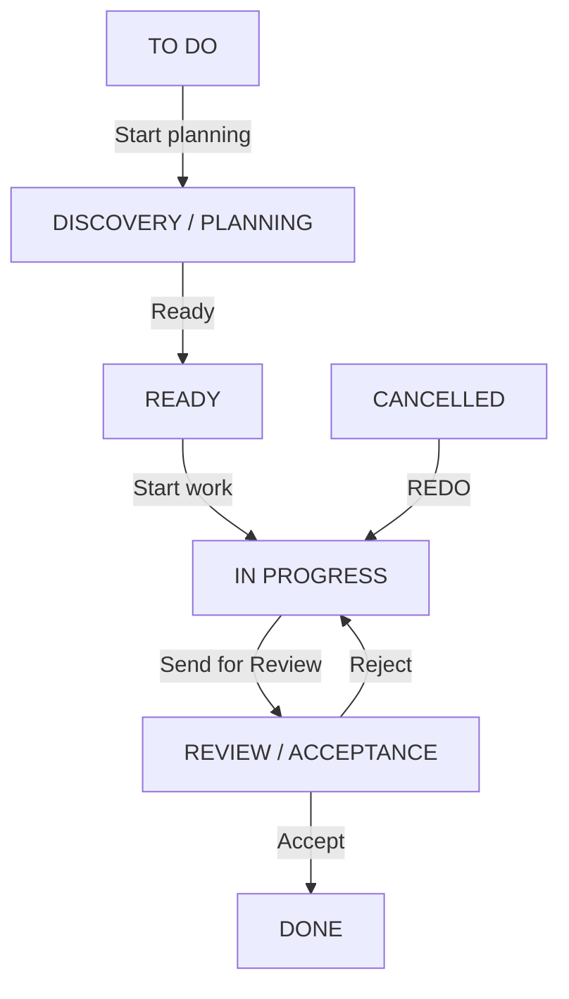
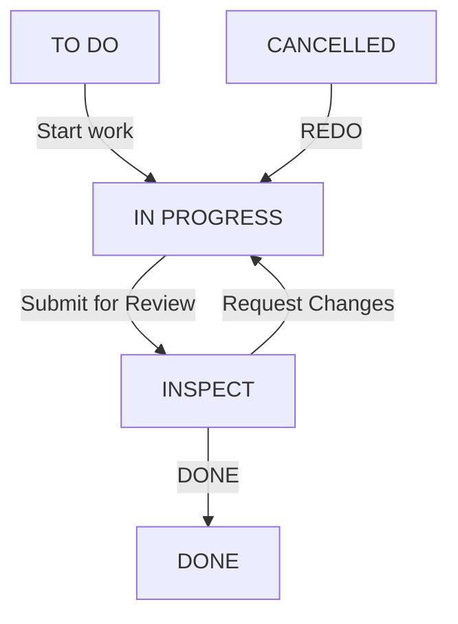
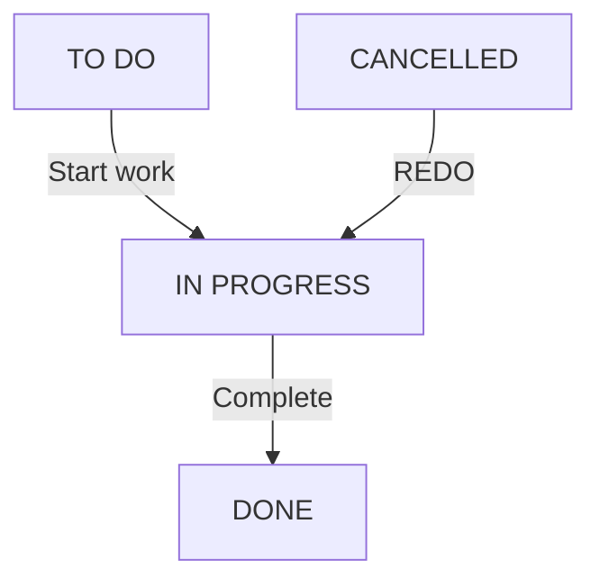

## 4. Tạo dự án và tài khoản nhóm

### Dự án trong OpenProject

Người A thực hiện trên môi trường tích hợp:

1. Tạo dự án **OpenProject AI Extension**, identifier dự kiến `op-ai`.
2. Bật Work packages, Wiki và Time and costs nếu nhóm cần ghi thời gian.
3. Tạo tài khoản A, B, C để nhận công việc; thêm vào Members của dự án.
4. Tạo các project role **PM**, **BA**, **BE**, **FE**, **Tester** trong Administration → Users and permissions → Roles and permissions [7]. Cấu hình quyền theo mục 4.1 và workflow riêng theo từng type ở mục 5; không dùng một workflow chung cho tất cả.
5. Gán quyền theo mục 4.1, đặc biệt tắt quyền sửa trực tiếp rộng cho BE/FE. PM quản lý thành viên và kế hoạch. Không cấp quyền xóa công việc cho tài khoản AI ở bản đầu.

Administrator là quyền toàn hệ thống; role PM trong dự án không tự có quyền sửa cấu hình toàn hệ thống. Người quản trị thực hiện phần workflow bên dưới [7]. Tránh đồng thời gán thêm role rộng quyền khi kiểm tra workflow, vì các quyền có thể cộng dồn.

### Các loại công việc

Vào Administration → Work packages → Types. Dùng loại đã có; tạo loại thiếu bằng **+ Type**, không đánh dấu là Milestone. Sau đó bật chúng tại Project settings → Work packages → Types [8][9].

| Type | Dùng để làm gì |
|---|---|
| Epic | Một mục tiêu lớn, ví dụ tích hợp AI hoặc báo cáo |
| Story | Kết quả người dùng cần, có tiêu chí chấp nhận |
| Task | Một việc triển khai cụ thể |
| Subtask | Phần nhỏ của task, có người và hạn riêng khi cần |
| Bug | Lỗi đã phát hiện, có bước tái hiện và liên kết nguồn |

Dùng quan hệ Parent/Child để tạo Epic → Story → Task → Subtask. Đây là quy ước nhóm; tên type không tự ép được toàn bộ cấu trúc phân cấp. A kiểm tra cấu trúc trong ứng dụng tích hợp. Với Bug, dùng quan hệ `relates` đến task nguồn và bản ghi xác nhận trong ứng dụng mở rộng, không coi mọi liên kết relates là nguyên nhân bug [10].

### API token

Đăng nhập tài khoản dự định dùng để tích hợp; vào My account → Access tokens để tạo token API [11]. API hành động với quyền tài khoản của token [2]. Bản phát triển một người có thể cấu hình token riêng ở backend. Khi bật phân quyền nhiều thành viên theo mục 4.1, token người dùng thường không có quyền sửa rộng; token tài khoản dịch vụ có quyền ghi chỉ được giữ trên backend do quản lý vận hành. Không phát token dịch vụ cho máy BE/FE, frontend, README, Git hoặc dữ liệu mẫu.

### 4.1. Phân quyền PM, BA, BE, FE và Tester

#### 4.1.1. Vai trò và phạm vi

| Role | Công việc chính | Phạm vi được sửa theo chính sách nhóm |
|---|---|---|
| PM — Project Manager | Quản lý kế hoạch, giao việc, hạn, nghiệm thu, điểm | Công việc trong dự án được quản lý; sửa kế hoạch phải có lý do |
| BA — Business Analyst | Phân tích yêu cầu, Epic/Story, tiêu chí chấp nhận | Nội dung nghiệp vụ của Epic/Story được chỉ định và task BA được giao |
| BE — Backend Developer | API, cơ sở dữ liệu, xử lý nghiệp vụ phía server | Trường thực thi của task/subtask/bug BE được giao trực tiếp cho mình |
| FE — Frontend Developer | Giao diện và tích hợp API | Trường thực thi của task/subtask/bug FE được giao trực tiếp cho mình |
| Tester | Kiểm thử, xác nhận bug, review kết quả | Task kiểm thử được giao; trường kết quả kiểm thử và trạng thái review được chỉ định |

A/B/C là **người được chia phần triển khai dự án mở rộng**, không phải role quyền cố định. Một người có thể làm nhiều chuyên môn, nhưng role phải được gán theo từng dự án và kiểm tra tổng quyền. BE trong bảng này là vai trò của thành viên sử dụng hệ thống; không đồng nghĩa người A/B đang viết backend của ứng dụng mở rộng.

Quy tắc mặc định được chọn: **BE/FE chỉ sửa task của chính mình**, chặt hơn việc cho mọi BE sửa mọi task BE. Task FE của đồng nghiệp cũng bị chặn đối với FE khác. Task chưa assign hoặc assign cho group chưa có cá nhân đại diện chỉ do PM điều phối; backend không tự mở quyền cho cả nhóm.

Mỗi work package cần `workstream` được PM duyệt: `BE`, `FE`, `BA`, `QA` hoặc `PM`; Epic/Story dùng thông tin người phụ trách nghiệp vụ. Bản đầu có thể lưu metadata này trong SQLite. Người dùng thường không được tự sửa workstream để vượt quyền. `assigneeId` lấy từ OpenProject hiện tại; `businessOwnerId` và `reviewerIds` là danh sách được PM/BA có thẩm quyền duyệt, không suy ra từ người tạo task.

#### 4.1.2. Ma trận quyền của ứng dụng mở rộng

Bảng sau là **chính sách cần lập trình trong backend của nhóm**, kết hợp quyền OpenProject và workflow. Đây không phải các ô cấu hình sẵn tương ứng một-một trong Community.

| Thao tác | PM | BA | BE | FE | Tester |
|---|---|---|---|---|---|
| Xem công việc trong dự án có quyền truy cập | Có | Có | Có | Có | Có |
| Bình luận trao đổi trong dự án | Có | Có | Có | Có | Có |
| Tạo Epic/Story | Có | Có, trong phạm vi nghiệp vụ được giao | Không | Không | Không |
| Sửa yêu cầu/tiêu chí của Epic/Story | Có | Có, là business owner | Không | Không | Chỉ đề xuất bằng bình luận |
| Tạo Task/Subtask | Có | Task BA của mình | Task BE của mình | Task FE của mình | Task QA của mình |
| Sửa mô tả thực thi của Task/Subtask | Có | Task BA của mình | Task BE của mình | Task FE của mình | Task QA của mình |
| Đổi assignee, workstream, parent hoặc type của công việc đã tạo | Có | Chỉ đề xuất | Không | Không | Không |
| Đổi hạn gốc, độ khó, tỷ lệ đóng góp đã duyệt | Có, lưu lý do/phiên bản | Chỉ đề xuất | Không | Không | Không |
| Task: TO DO → IN PROGRESS → REVIEW | Khi được giao phù hợp | Task BA của mình | Task BE của mình | Task FE của mình | Task QA của mình |
| Task: REVIEW → DONE/IN PROGRESS | Có, nếu không tự review | Chỉ nếu là reviewer nghiệp vụ được chỉ định | Không | Không | Có, nếu là reviewer được chỉ định |
| Subtask: IN PROGRESS → DONE (Complete) | Subtask của mình | Subtask BA của mình | Subtask BE của mình | Subtask FE của mình | Subtask QA của mình |
| Any → CANCELLED; CANCELLED → IN PROGRESS (REDO) | Có, theo mục 5.6 | Chỉ đề xuất | Không | Không | Không |
| Chấp nhận Done của Epic/Story | Có, nếu đạt điều kiện | Chỉ đề xuất nghiệm thu | Không | Không | Chỉ cung cấp kết quả kiểm thử |
| Tạo Bug với mô tả và bằng chứng | Có | Có | Có | Có | Có |
| Duyệt bug hợp lệ, mức độ và task nguồn | Có | Chỉ đề xuất | Chỉ đề xuất | Chỉ đề xuất | Có, theo phạm vi review được giao |
| Sửa nội dung khắc phục của Bug | Có | Bug BA được giao | Bug BE được giao | Bug FE được giao | Trường kết quả kiểm thử của bug được giao |
| Xem bảng điểm | Toàn dự án | Toàn dự án | Điểm của mình, tổng hợp nhóm | Điểm của mình, tổng hợp nhóm | Điểm của mình, tổng hợp nhóm |
| Đổi công thức/chốt hoặc hiệu chỉnh điểm | Có, có version/lý do | Không | Không | Không | Không |
| Xóa work package | Không qua ứng dụng ở bản đầu | Không | Không | Không | Không |

Task/Subtask tạo mới của BE/FE/BA/Tester mặc định TO DO, assign chính người đó, workstream khớp role. PM duyệt kế hoạch/baseline trước Start work; READY chỉ có trong workflow Epic. Người tạo được chỉnh nội dung bản nháp trong phạm vi của mình; việc tự tạo không cấp quyền sửa công việc người khác. Khi gắn Subtask mới vào parent khác người phụ trách, cần PM duyệt quan hệ; quyền tạo không đồng nghĩa quyền sửa parent.

BA chỉ sửa trường nghiệp vụ của Epic/Story, không tự điều chỉnh baseline hoặc trạng thái Done. Tester review task BE/FE chỉ được ghi kết quả kiểm thử, bằng chứng và chuyển trạng thái review hợp lệ; không tự sửa yêu cầu, người được giao hoặc độ khó. Bug đã được duyệt không cho tác giả tự thay task nguồn/severity để giảm điểm trừ.

#### 4.1.3. Ví dụ BE không được sửa task assign FE

Giả sử task 123 có workstream FE, assignee là tài khoản của Lan. Minh có role BE, đăng nhập bằng tài khoản riêng:

- Minh được xem và bình luận trao đổi nếu có quyền xem dự án.
- Minh bị chặn sửa subject, description, ngày, priority, assignee, parent và status của task 123.
- Minh yêu cầu AI “chuyển task 123 sang Done” cũng bị chặn với lỗi quyền; MCP không gửi yêu cầu ghi sang OpenProject.
- Minh không được dùng một lệnh đổi assignee thành mình rồi sửa trong cùng request để lách kiểm tra.
- Chỉ PM được điều phối lại. Nếu giao sang BE, PM phải duyệt thay workstream/phạm vi và cập nhật baseline/tỷ lệ đóng góp theo lịch sử, không ghi đè người nhận điểm cũ.

Ngay cả task BE được assign cho một BE khác, Minh vẫn không được sửa theo quy tắc “chỉ task của chính mình”. Nếu cùng làm, PM tách Subtask riêng cho từng người. Việc ghi nhận tỷ lệ đóng góp để tính điểm không tự cấp quyền sửa task.

#### 4.1.4. Khả năng sẵn có của Community và phương án áp dụng

OpenProject có quyền **Edit work packages** ở cấp dự án và quyền **Change work package status** độc lập. Workflow có điều kiện User is assignee, nhưng điều kiện đó áp dụng cho chuyển trạng thái, không tự hạn chế việc sửa toàn bộ nội dung theo assignee [23][15]. Các nguồn đã kiểm tra không cung cấp một quyền cấu hình chung “chỉ sửa mọi trường của task assign mình”. Không được ghi rằng chỉ tạo role BE/FE là đã hoàn thành yêu cầu này.

Phương án mặc định cho nhóm:

1. OpenProject gốc dùng để xem task, lịch sử và bình luận. BA/BE/FE/Tester không được cấp **Edit work packages** hoặc **Change work package status** trực tiếp ở cấu hình nghiêm ngặt.
2. Mọi thao tác tạo/sửa/chuyển trạng thái theo ma trận thực hiện qua giao diện mở rộng hoặc AI → MCP → backend có kiểm tra quyền. PM có thể có quyền quản lý trực tiếp trong OpenProject theo phạm vi được tin cậy.
3. Backend giữ token của **tài khoản dịch vụ không phải Administrator**, chỉ có các quyền cần dùng trong dự án. Backend xác thực người thao tác và kiểm tra ma trận trước khi dùng token đó; token dịch vụ không phải danh tính của người yêu cầu.
4. Backend dịch vụ chỉ được PM/người vận hành kiểm soát. Trên máy thành viên, MCP stdio kết nối backend bằng danh tính đã xác thực của thành viên; không nhúng token dịch vụ vào chương trình local mà thành viên có thể đọc hoặc sửa.
5. Nếu muốn BE/FE sửa trực tiếp mọi trường trên UI OpenProject mà vẫn giới hạn theo assignee, cần bổ sung kiểm tra phía server OpenProject bằng một mở rộng được phát triển/kiểm thử riêng, hoặc một cơ chế quyền cấp từng work package đã được xác minh. Bộ scaffold hiện tại không có chức năng đó. Chặn tại MCP hoặc ẩn nút UI không chặn được đường sửa trực tiếp khi tài khoản vẫn có quyền Edit rộng.

Mỗi người vẫn có thể phát triển bằng mock/môi trường riêng như mục 12. Khi cả nhóm dùng một hệ thống thật, phải có backend đáng tin cậy và xác thực; ba bản local do từng thành viên toàn quyền quản lý không tạo được một ranh giới quyền chung đáng tin cậy.

#### 4.1.5. Cấu hình project role trong OpenProject

Administrator thực hiện tại Administration → Users and permissions → Roles and permissions, tạo project role (không đánh dấu Global role), rồi gán qua Members của dự án:

| Quyền gốc OpenProject | PM | BA/BE/FE/Tester trong cấu hình nghiêm ngặt | Tài khoản dịch vụ |
|---|---|---|---|
| View work packages | Bật | Bật | Bật |
| Add comments / Edit own comments | Bật | Bật | Bật nếu ứng dụng hỗ trợ |
| Become assignee/responsible | Bật | Bật | Theo nhu cầu, không cần là người thực hiện task |
| Add work packages / Edit work packages | Bật theo nhiệm vụ | Tắt; dùng ứng dụng mở rộng | Bật trong dự án đích |
| Change work package status | Bật | Tắt; dùng ứng dụng mở rộng | Bật và cấu hình workflow riêng phù hợp |
| Manage work package relations/hierarchies | Bật | Tắt | Bật theo các thao tác được hỗ trợ |
| Add attachments | Theo nhu cầu | Tắt nếu phải kiểm tra quyền theo task; gửi qua ứng dụng | Chỉ bật khi có chức năng upload kiểm tra quyền |
| Move/Duplicate/Delete work packages | Tắt ở bản đầu nếu không cần | Tắt | Tắt |
| Manage members / cấu hình dự án | PM theo nhiệm vụ | Tắt | Tắt |
| Administrator / quyền quản trị toàn hệ thống | Không mặc định | Tắt | Tắt |

Nguồn [23] mô tả ý nghĩa các quyền. Bảng bật/tắt này là đề xuất của nhóm. Không dùng Non-member/Anonymous để cho truy cập dự án riêng; kiểm tra các role bổ sung hoặc group không cấp lại quyền đã tắt. Add attachments hoạt động độc lập với Edit work packages, vì vậy phải kiểm tra riêng [23].

Workflow mục 5 thể hiện chính sách nghiệp vụ. Trong cấu hình nghiêm ngặt, tài khoản người dùng thường không đổi trạng thái trực tiếp; backend áp ma trận role/người được giao/người review, rồi dùng workflow của tài khoản dịch vụ để ghi. Workflow của tài khoản dịch vụ phải hỗ trợ những chuyển trạng thái đã được backend cho phép. Điều kiện User is assignee của role BE không tự áp dụng khi OpenProject thấy tài khoản dịch vụ là người ghi.

#### 4.1.6. Kiểm tra bắt buộc trong backend/AI-MCP

Người A xây `auth/` và `permissions/`, dùng chung cho REST/MCP. Trình tự mỗi thao tác:

1. Xác thực actor từ phiên đăng nhập/token đã kiểm chứng; không tin `actorId`, `role=PM` hay câu “tôi là PM” trong prompt/body của AI.
2. Lấy role và quyền trong dự án, công việc hiện tại, assignee, workstream, businessOwner/reviewer và trạng thái từ nguồn đáng tin cậy.
3. Kiểm tra cả quyền thao tác và từng trường thay đổi. BE/FE cần đúng role/workstream và `actor.userId == currentAssigneeId`; task đang DONE/CANCELLED không cho sửa thực thi nếu chưa được mở lại hợp lệ.
4. Thay đổi assignee/type/workstream/parent/baseline chỉ thuộc PM. Đánh giá bằng dữ liệu **trước thay đổi**; không cho payload tự chuyển quyền cho actor.
5. Reviewer phải được chỉ định, không phải người thực hiện/nhận đóng góp của task. PM tự làm task cũng cần người review khác hoặc ngoại lệ được phê duyệt, ghi rõ lý do.
6. Dùng lockVersion; nếu task được PM đổi assignee trong lúc thao tác, từ chối bản ghi cũ và kiểm tra quyền lại trên bản mới.
7. Ghi audit actor thực, tài khoản dịch vụ, task ID, action, thay đổi, kết quả, thời gian. OpenProject có thể hiển thị tài khoản dịch vụ là người ghi; không được diễn giải đó là người làm task.
8. Request nhiều task kiểm tra từng mục trước khi ghi. Nếu kế hoạch có mục không được phép, bản đầu từ chối cả kế hoạch và trả danh sách nguyên nhân; lỗi phát sinh sau khi ghi phải báo chính xác các mục đã/ chưa cập nhật.

Không dùng endpoint cập nhật tổng quát hoặc chuyển tiếp payload tùy ý để bypass `permissions/`. Với quan hệ cha/con hoặc bug nguồn, kiểm tra các đầu mút liên quan. Cấu hình quyền phải được version hóa; nguồn role hoặc task không lấy được thì không cho ghi theo dữ liệu cũ.

#### 4.1.7. Phân công bổ sung và nghiệm thu

| Người triển khai | Bổ sung vào phần việc |
|---|---|
| A | Xác thực actor, ma trận role/trường, kiểm tra assignee, bảo vệ mọi tool MCP/REST và tài khoản dịch vụ |
| B | Lưu metadata workstream/businessOwner/reviewer, lịch sử giao lại, audit và ánh xạ ID; báo cáo đúng phạm vi được xem |
| C | Giao diện chỉ cho thao tác hợp lệ, giải thích bị chặn, giới hạn bảng điểm cá nhân; backend vẫn kiểm tra độc lập |

Các tình huống phải được kiểm tra trên hệ thống đã triển khai:

| Tình huống | Kết quả mong đợi |
|---|---|
| BE sửa nội dung/chuyển trạng thái task FE | Từ chối; dữ liệu task không đổi |
| BE sửa task BE của chính mình | Cho phép các trường thực thi và chuyển trạng thái hợp lệ |
| BE sửa task BE của người khác hoặc task chưa assign | Từ chối |
| FE đổi assignee/workstream/type để tự nhận quyền | Từ chối |
| BA sửa tiêu chí Story mình phụ trách | Cho phép; không đổi baseline/Done |
| Tester được chỉ định review task BE | Cho phép ghi kết quả và REVIEW → DONE/IN PROGRESS; không sửa mô tả thực thi |
| Tester không được chỉ định review task đó | Từ chối thao tác review; vẫn được bình luận theo quyền |
| PM đổi assignee sang FE | Cho phép, có audit; BE mất quyền sửa ngay sau đổi |
| Actor giả PM trong prompt/payload, hoặc dùng ID task dự án khác | Từ chối |
| BE gọi thẳng OpenProject API hoặc UI để sửa task FE | Bị từ chối vì role gốc không có quyền sửa trực tiếp rộng |
| Bulk update chứa cả task BE của mình và task FE | Từ chối kế hoạch trước ghi ở bản đầu |
| BE gọi API bảng điểm cá nhân của người khác | Không trả chi tiết ngoài phạm vi; chỉ tổng hợp được phép |

Đây là tiêu chí nghiệm thu thiết kế, không phải kết quả test đã chạy. Tài liệu và ZIP chưa chứa implementation phân quyền. Chỉ xem chức năng hoàn thành khi các phép thử UI, REST, MCP và gọi API trực tiếp đều đạt theo mô hình được chọn.

## 5. Workflow Epic, Story, Task và Subtask theo ảnh nhóm cung cấp

**Nguồn nghiệp vụ:** bốn ảnh ngày 10/10/2026, theo thứ tự Epic, Story, Task, Subtask. Các luồng dưới đây thay thế workflow chung ở phiên bản 1.1. Tên trạng thái và hành động giữ đúng ảnh; quyền thực hiện và điều kiện nghiệm thu là chính sách bổ sung của nhóm, không được suy ra từ ảnh.

**Workflow là các chuyển trạng thái được phép theo Type và Role.** Người quản trị cấu hình trạng thái và workflow trong Administration → Work packages [12][15]. Trong mô hình phân quyền nghiêm ngặt ở mục 4.1, backend kiểm tra actor thật rồi ghi bằng tài khoản dịch vụ; workflow của dịch vụ không thay thế kiểm tra quyền người dùng.

### 5.1. Danh sách trạng thái và quy ước

| Trạng thái | Áp dụng | Ý nghĩa | Closed? |
|---|---|---|---|
| TO DO | Cả bốn type | Đã tạo, chưa bắt đầu | Không |
| DISCOVERY / PLANNING | Epic | Khám phá phạm vi, lập kế hoạch | Không |
| READY | Epic | Kế hoạch Epic đã sẵn sàng | Không |
| IN PROGRESS | Cả bốn type | Đang thực hiện | Không |
| REVIEW / ACCEPTANCE | Epic | Đang nghiệm thu mục tiêu Epic | Không |
| INSPECT | Story | Kiểm tra kết quả theo tiêu chí Story | Không |
| REVIEW | Task | Review công việc triển khai | Không |
| DONE | Cả bốn type | Hoàn tất theo điều kiện của type | Có |
| CANCELLED | Cả bốn type | Đã hủy, có thể REDO | Có |

`START` là điểm khởi tạo, `Any` biểu thị mọi trạng thái nguồn, còn Create, REDO, Reject, Request Changes… là **tên hành động chuyển trạng thái**, không phải trạng thái riêng. Không tạo trạng thái START, Any hoặc REDO. Không dùng NEW hoặc REWORK cho bốn type này. READY chỉ dành cho Epic; Subtask không có REVIEW/INSPECT.

Đặt **TO DO** làm trạng thái khởi tạo của cả bốn type. CANCELLED đóng về kỹ thuật nhưng không được tính hoàn thành/điểm. DONE của Subtask là hoàn tất do người thực hiện khai báo; nghiệm thu độc lập và điểm được kiểm soát ở task cha (mục 5.7). Không nhận biết hoàn thành chỉ bằng `% Complete = 100`.

### 5.2. Epic — ảnh 1

| Từ | Hành động trong ảnh | Đến |
|---|---|---|
| START | Create | TO DO |
| TO DO | Start planning | DISCOVERY / PLANNING |
| DISCOVERY / PLANNING | Ready | READY |
| READY | Start work | IN PROGRESS |
| IN PROGRESS | Send for Review | REVIEW / ACCEPTANCE |
| REVIEW / ACCEPTANCE | Reject | IN PROGRESS |
| REVIEW / ACCEPTANCE | Accept | DONE |
| Any | Không ghi nhãn trong ảnh | CANCELLED |
| CANCELLED | REDO | IN PROGRESS |

PM chấp nhận Epic khi các Story bắt buộc đã được nghiệm thu và mục tiêu Epic đạt. Epic bị Reject quay thẳng về IN PROGRESS; không thêm bước REWORK.

### 5.3. Story — ảnh 2

| Từ | Hành động trong ảnh | Đến |
|---|---|---|
| START | Create | TO DO |
| TO DO | Start work | IN PROGRESS |
| IN PROGRESS | Submit for Review | INSPECT |
| INSPECT | Request Changes | IN PROGRESS |
| INSPECT | DONE | DONE |
| Any | Không ghi nhãn trong ảnh | CANCELLED |
| CANCELLED | REDO | IN PROGRESS |

Trong ảnh, DONE vừa là nhãn hành động vừa là trạng thái đích. Story không đi qua READY hoặc REVIEW. PM nghiệm thu Story khi tiêu chí chấp nhận đạt và các Task bắt buộc đã được chấp nhận; BA/Tester cung cấp kết quả kiểm tra.

### 5.4. Task — ảnh 3

| Từ | Hành động trong ảnh | Đến |
|---|---|---|
| START | Create | TO DO |
| TO DO | Start work | IN PROGRESS |
| IN PROGRESS | Submit for Review | REVIEW |
| REVIEW | Request Changes | IN PROGRESS |
| REVIEW | Approve | DONE |
| Any | Không ghi nhãn trong ảnh | CANCELLED |
| CANCELLED | REDO | IN PROGRESS |

Người được giao gửi Task sang REVIEW. PM hoặc reviewer được chỉ định chấp nhận/yêu cầu sửa; không tự review công việc có phần đóng góp của mình. Request Changes quay thẳng về IN PROGRESS. BE/FE không tự Approve Task của mình.

### 5.5. Subtask — ảnh 4

| Từ | Hành động trong ảnh | Đến |
|---|---|---|
| START | Create | TO DO |
| TO DO | Start work | IN PROGRESS |
| IN PROGRESS | Complete | DONE |
| Any | Không ghi nhãn trong ảnh | CANCELLED |
| CANCELLED | REDO | IN PROGRESS |

Theo ảnh, Subtask không có bước review riêng. Người được giao có thể Complete Subtask của chính mình khi có bằng chứng hoàn thành, đúng workstream, đạt checklist và có task cha hợp lệ. Đây là khai báo hoàn tất; reviewer vẫn nghiệm thu các phần này khi duyệt task cha. Không tự thêm REVIEW vào workflow Subtask.

### 5.6. Quyền chuyển trạng thái và Any/REDO

| Type / hành động | Người được phép trong ứng dụng mở rộng | Điều kiện bổ sung |
|---|---|---|
| Epic: Start planning, Ready, Start work, Send for Review | PM; BA là business owner được giao | READY cần kế hoạch/phạm vi và tiêu chí được PM duyệt |
| Epic: Reject, Accept | PM | Không tự nghiệm thu; Accept kiểm tra Story bắt buộc |
| Story: Start work, Submit for Review | PM; BA là business owner được giao | Phạm vi đã được PM duyệt; không bỏ qua IN PROGRESS |
| Story: Request Changes | PM; BA/Tester là reviewer được chỉ định | Không tự review; ghi lý do và bằng chứng |
| Story: INSPECT → DONE | PM | Tiêu chí đạt; các Task bắt buộc đã được nghiệm thu |
| Task: Start work, Submit for Review | Assignee BA/BE/FE/Tester đúng workstream; PM khi được giao task đúng phạm vi | Baseline được duyệt trước Start work |
| Task: Request Changes, Approve | PM hoặc BA/Tester là reviewer được chỉ định | Không tự review; Approve kiểm tra Subtask bắt buộc |
| Subtask: Start work, Complete | Assignee đúng workstream; PM khi là assignee hợp lệ | Checklist/bằng chứng; không thay thế nghiệm thu task cha |
| Cả bốn type: Any → CANCELLED | PM | Bắt buộc lý do; hủy việc đang DONE là ngoại lệ có xác nhận rõ |
| Cả bốn type: CANCELLED → IN PROGRESS (REDO) | PM | Duyệt mở lại, xác định phạm vi/baseline; không tự cộng thêm điểm |

`Any → CANCELLED` trong ảnh bao gồm cả DONE. Khi cấu hình, cho phép từ từng trạng thái của type **trừ CANCELLED**; không cần vòng lặp CANCELLED → CANCELLED. Backend chặn người dùng thường hủy hoặc REDO. Với DONE → CANCELLED, PM cần xác nhận rõ ảnh hưởng báo cáo và ghi audit; ảnh không quy định tên hành động hủy nên tài liệu chỉ gọi là “Hủy” để diễn đạt.

Không có cạnh DONE → IN PROGRESS trực tiếp trong ảnh. Mở lại công việc đã DONE theo đúng luồng: **DONE → CANCELLED → IN PROGRESS**. Không tự quay TO DO hoặc REWORK. Hủy/REDO một parent không tự đổi toàn bộ child: PM lập kế hoạch phạm vi, xác nhận những child cần mở lại và backend kiểm tra quyền từng bản ghi. Child CANCELLED chưa được miễn trừ rõ ràng không được coi là child đã nghiệm thu.

### 5.7. Cấu hình OpenProject và AI/MCP

1. Tạo/reuse đúng các trạng thái mục 5.1; chọn Closed cho DONE và CANCELLED. Cấu hình TO DO mặc định và kiểm tra khởi tạo của từng type. Nếu hệ thống có dữ liệu cũ, lập mapping/chuyển đổi có kiểm soát; không đổi tên/xóa trạng thái đang được type khác sử dụng chỉ để sửa demo.
2. Mở workflow của từng Type và Role. Trong ma trận, tích **hàng trạng thái hiện tại → cột trạng thái đích** đúng bảng riêng mục 5.2–5.5 [15]. Không copy nguyên workflow Task sang Story/Subtask/Epic.
3. Với tài khoản dịch vụ, cho phép đủ các cạnh cần ghi của từng type; backend thực thi bảng 5.6 cho actor thật. Với mô hình native hạn chế, User is assignee chỉ hỗ trợ giới hạn chuyển trạng thái; không thay thế quyền sửa field theo mục 4.1. Không cấp thêm User is author để vượt assignee.
4. Các nhãn hành động trong ảnh được lưu trong hợp đồng nghiệp vụ/UI/MCP. Việc tích ô chuyển trạng thái không bảo đảm OpenProject tự tạo nút có đúng nhãn “Accept” hoặc “Submit for Review”; adapter ghi status đích tương ứng.
5. A triển khai công cụ dự kiến `get_allowed_transitions(workPackageId)` và `transition_work_package(workPackageId, action, reason?, expectedLockVersion, requestId)`. Đây là tool riêng cần xây, không phải tool đã có sẵn trong ZIP. Backend xác thực actor, đọc type/status/assignee/reviewer hiện tại, đối chiếu cạnh và điều kiện, rồi mới gọi API cập nhật với lockVersion [18].
6. `update_work_package` có đổi status cũng phải đi qua cùng chính sách; không để tool cập nhật chung bỏ qua workflow. AI không được tự suy ra quyền từ prompt hoặc dùng một luồng chung cho mọi type. Ví dụ “đưa Story sang review” phải ánh xạ Submit for Review → INSPECT; “hoàn tất Task” từ IN PROGRESS không được nhảy DONE; “hoàn tất Subtask” có thể Complete → DONE nếu actor hợp lệ.
7. Không tự đổi trạng thái parent chỉ vì tất cả child đang DONE. AI chỉ đề xuất; thao tác nghiệm thu parent vẫn cần đúng người, đúng bước và tiêu chí. Bulk update kiểm tra từng type, từng cạnh, từng quyền trước ghi; lỗi một bước trả rõ những gì đã ghi, không báo thành công toàn bộ.

**Baseline và điểm:** READY chỉ có trên Epic. Task/Subtask được PM duyệt baseline khi còn TO DO, trước Start work; không cần tạo thêm READY để lưu baseline. Với Task không có Subtask, `acceptedAt` là thời điểm Approve đạt. Với Subtask cuối cây, lưu riêng `completedAt` khi assignee bấm Complete và `acceptedAt` khi task cha được reviewer chấp nhận phần việc đó. Chỉ tính hoàn thành được nghiệm thu/điểm cho Subtask khi có `acceptedAt` đáng tin cậy; DONE đơn thuần chưa đủ. Nếu phát sinh Subtask mới sau lần duyệt parent, cần lần nghiệm thu mới, không dùng lại thời điểm cũ. Giữ các lần nghiệm thu/baseline/score-run cũ khi CANCELLED/REDO; task cha không được cộng điểm cùng child.

Mẫu chính sách nằm ở `packages/contracts/workflow-policy.example.json` trong ZIP. Đây là cấu hình tham chiếu, không phải implementation quyền hay payload import OpenProject; ID thật được ánh xạ riêng từng instance. A/B/C cần thống nhất và version hợp đồng trước khi tích hợp.

### 5.8. Bug và kiểm tra nghiệm thu

Bốn ảnh không bao gồm Bug. Luồng Bug tạm đề xuất riêng: TO DO → IN PROGRESS → REVIEW → DONE, REVIEW → IN PROGRESS khi Request Changes, PM hủy/REDO như Task. Nhóm cần duyệt luồng Bug trước triển khai; không coi đó là nội dung suy ra từ ảnh. Xác nhận bug hợp lệ là thuộc tính riêng, không đồng nghĩa bug đã sửa DONE; bug hợp lệ còn mở vẫn được tính chất lượng.

| Phép thử cần thực hiện | Kết quả mong đợi |
|---|---|
| Tạo mỗi type | Đều ở TO DO |
| Epic chạy luồng chính và Reject | Có DISCOVERY / PLANNING, READY, REVIEW / ACCEPTANCE; Reject về IN PROGRESS |
| Story gửi kiểm tra | Đến INSPECT; Request Changes về IN PROGRESS |
| Task gửi review/Approve | Đến REVIEW; chỉ người nghiệm thu hợp lệ cho DONE |
| Assignee Complete Subtask của mình | IN PROGRESS → DONE; không có REVIEW; điểm chờ nghiệm thu task cha |
| BE sửa/đổi trạng thái việc assign FE, kể cả Subtask | Từ chối qua UI, REST và AI/MCP theo mục 4.1 |
| AI yêu cầu Task IN PROGRESS → DONE hoặc Story → REVIEW | Từ chối cạnh không tồn tại; gợi ý bước hợp lệ |
| PM hủy ở từng trạng thái, kể cả DONE | CANCELLED; có lý do, ngoại lệ DONE cần xác nhận và audit |
| PM REDO | CANCELLED → IN PROGRESS; không cộng trùng lần hoàn thành |
| Task có Subtask chưa đạt hoặc Story/Epic thiếu child bắt buộc | Không nghiệm thu parent |
| Assignee/reviewer đổi hoặc lockVersion xung đột | Đọc lại và kiểm tra quyền/cạnh; không ghi đè |

Các phép thử trên là tiêu chí cần triển khai và chạy, chưa phải kết quả kiểm thử ứng dụng. Bộ khung chỉ cung cấp tài liệu/cấu hình mẫu.

Nguồn và bối cảnh đầy đủ: [README](../README.md), mục 14.
